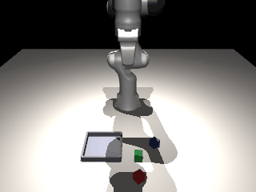
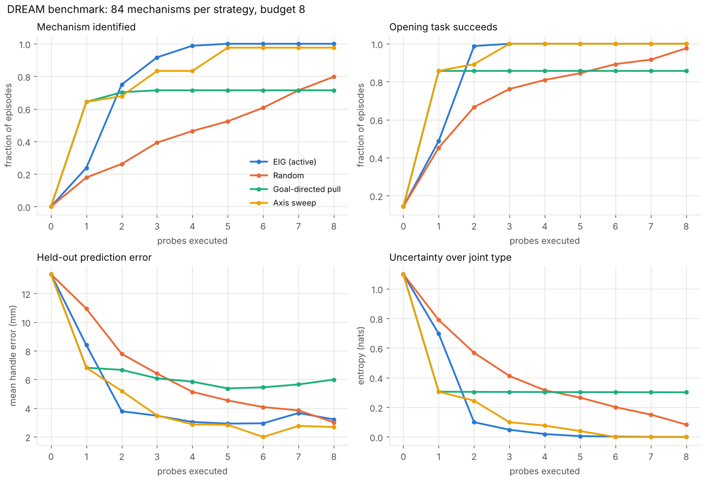
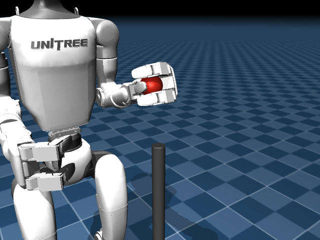
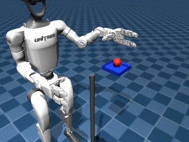

# DREAM

**Long-term mission.** DREAM is a research project toward general-purpose embodied artificial
intelligence: a system that receives an unfamiliar physical goal, works out from what it observes
and what it can physically do what needs to happen, acquires missing knowledge by observation and
experiment, adapts to failure, and completes the task or recognises that it cannot, without a
task-specific program per goal. This is the direction, **not a current capability**, and
generality is something we measure, not assume. The behavioural contract, anti-overfitting
rules, architecture and engineering standards are in [`AGENTS.md`](AGENTS.md).

**What exists today: two foundations, now connected in one narrow task.**

1. **Active Physical Discovery** (abstract gantry robot). A simulated robot meets a mechanism it
   has never seen, a panel with a handle that might be fixed, slide, or swing on a hinge. It
   keeps competing explanations of how the panel moves, picks the physical experiment expected
   to best tell them apart, predicts what that experiment will do, runs it, updates its beliefs
   from what it measures, and then opens the mechanism.
2. **A Panda manipulation foundation.**
   - A simulated Franka Panda (MuJoCo Menagerie model) grasps cubes through real finger contact.
   - Closed-loop skills, a typed tool interface and a rule-based task runtime carry out
     *structured* goals: "in red tray", or "on red blue" (stack red on blue).
   - It recovers from dropped objects, clears obstructions, and runs as a live session that can
     be paused or cancelled.
   - This baseline takes structured goals. The separate model runtime accepts language; no experience memory is implemented.
3. **Discovery as a tool on the Panda (milestone 11).** For "in red compartment", the Panda
   probes a closed box whose mechanism is hidden (drawer, lid or fixed) through its own compliant
   controller, using the same belief and EIG code as the gantry. It then opens the box along the
   learned constraint or declines, places the cube and verifies. This runs in one continuous
   simulation, on a deliberately narrowed scene (knob handle, 5 cm cavity, counterbalanced lid):
   see the [audit of simplifications](#audit-of-milestone-11-changes).
4. **Camera perception (milestone 10, first slice).** A calibrated RGB-D camera and a classical
   RGB-D pipeline replace the object tracker for tabletop pick-and-place: the Panda finds cubes
   and the tray in images, grasps and places from those estimates, and verifies from new frames
   (held-out 39/40 against the oracle tracker's 40/40). It is a colour-and-depth baseline for
   box-like objects, not open-world vision. Camera-driven *mechanism discovery* remains
   unreliable: the original development run was 0/12; the continuation diagnostic completed
   both lids but neither drawer on two new development seeds. Held-out compartment results
   still use the oracle tracker.
5. **Real multimodal tool calling, evaluated on two development tasks.** Qwen3-VL-4B-Instruct
   ran on an NVIDIA L4 and selected named tools from language, camera frames and fresh scene
   observations. Both red/blue tray tasks completed with independent verification (2/2),
   matching the classical baseline (2/2), with no false claims or protective stops. This is
   semantic tool selection over classical motor skills, not learned continuous-action control
   or broad generalisation. Raw requests, outputs, RGB-D calibration, timing and GPU telemetry
   are in `results/qwen_cloud_pilot_dev`. A learned-action model has since executed six fresh
   predicted joint targets with measured tracking, but failed its manipulation task (below).
   Useful learned manipulation remains unvalidated. The Booster T1 Isaac route stopped after
   four PPO actions (a measured-state guard rejected a knee excursion); humanoid walking is now
   validated by a different route (item 6).
6. **A walking G1 that explores rooms (Milestones A and B).** NVIDIA's released Decoupled WBC
   walk/balance policies, run with their verified contract, walk a free-standing Unitree G1
   in MuJoCo: no falls across all pre-registered locomotion tests, 30/30 go-to goals, pushes
   up to 120 N recovered. On top, a classical agent maps unfamiliar procedural rooms from the
   robot's head camera, finds the cabinet (a box with a handle) among distractors and stands
   where it can examine it; how the cabinet opens is reported as unknown. Odometry is
   oracle-assisted. See [Mobile G1](#mobile-g1-pretrained-whole-body-locomotion-and-room-exploration).



The discovery loop:

```
observe -> hypothesise -> predict -> act (probe) -> measure -> update -> ... -> operate
```

Discovery is explicit Bayesian system identification with information-seeking probes in MuJoCo,
with no learned components (Stage Zero and One of the Physics Apprentice research plan). In the
long-term architecture it becomes a tool that the task runtime calls when a skill meets
unfamiliar physical behaviour.

## Status

Every row marked "implemented and tested" has passing tests and/or saved results in `results/`.

**Cloud recovery completed (25 Oct 2026).** The interrupted run
`dream-qwen-20261025-102015-402461` at `a034cc7` exited **124** while rendering the last
baseline recording. All **4,733 downloaded files / 2,858,084,373 bytes** now verify:
4,730 against the final guest SHA-256 manifest, and the manifest plus two active logs
against final Cloud Storage MD5/size metadata. The original source archive also verifies.
Original bytes and the complete per-file verification remain outside Git/OneDrive at
`C:/Users/24adi/AppData/Local/DREAM/cloud_runs/dream-qwen-20261025-102015-402461`.
The interrupted two-view recording was recovered from 123 saved integration states in
a separate directory: no physics rerun, frame interpolation or raw-output overwrite.
Only after verification was the temporary bucket removed. Independent inventory confirms
zero VMs, disks, addresses, routers or secrets, with only the default VPC. No GPU resources
were created during recovery. Original estimate US$4.28 / allowance US$5; billed cost is
unavailable. Verification, provenance, cleanup and recovered-video hashes are in
`results/g1_autonomy_recovery`.

The **original eight-attempt evaluation remains incomplete: seven finalized, one missing
finalized baseline entry**. Full retrieval found terminal physics for all eight, including
the last baseline, but its unpublished terminal summary is diagnostic-only. Offline video
recovery does not finalize or rerun the comparison. The earlier partial-download analysis
is retained in `results/g1_autonomy_cuda_frozen`; the final recovered report is separate.
Qwen: **1/4 independent physical placements**, **1/4 safe refusals**, **2/4 conditional
outcomes**, **0/4 agent-verified successful completions** and **zero observed false claims**.
Its successful physical placement was followed by a decline after the unsupported `on`
verification argument; the goal-schema fix was applied afterward, never retroactively.
The baseline has zero successful placements across its three finalized attempts; the
fourth planned slot stays incomplete and does not earn a safe-refusal score. No complete
paired or generalisation result is claimed. All 32 genuine model outputs remain preserved.

The offline phase audit isolates release failures: shifted-object carry drift is about
1 mm, then asymmetric unloading imparts lateral motion; the sphere rolls off the platform
and the largest penetration occurs on floor impact. Original peak penetrations are
6.35/7.40 mm for Qwen/baseline on `free_shift`, and 5.44/5.37 mm on `unseen_free`.
Reprocessing all 15 saved development-cloud detections locally reproduces their centres
exactly. Initial rendered images differ but initial centre estimates agree; trajectories
diverge later in probe/carry. Native numeric/contact sensitivity remains unisolated, so
this does not identify the renderer or GPU as the sole cause. Frozen results are unchanged.

The release-development correction lowers from the estimated sphere radius and three-sigma
pose uncertainty, observes proximity to support, and preserves grip on ordinary skill
failure. Protective stops still use the original hard hold; release now shares the existing
two-failure recovery budget. Controller limits, scene geometry and independent scoring
expressions are byte/AST verified unchanged in `safety_preservation.json`.
Terminal-state diagnostics show continuing two-finger object contact in the heavier and
independent small-object failures, with **wrist-yaw body / target-platform collision**
(about 1.74 N and 1.47 N summed normal force) while the sphere remains above support.
No arm joint is near its limit. This explains an obstruction to further lowering; the
object-only contact trace did not expose the wrist contact. This is a failed release,
not a safe-refusal success. The diagnostic restores saved states without stepping physics.
The next measurable target is a collision-aware placement approach/orientation that
completes unloading and withdrawal across these four development cases, followed by a
fresh preregistered eight-episode development check: at least seven verified placements,
all below the unchanged 1 mm penetration gate, zero falls and zero false claims. The
current correction does not yet meet that target; no full model evaluation is justified.

Matched local release development (two preserved failures plus two predetermined additional
sphere cases; all now development evidence):

| Skill revision | Verified placements | Episodes over 1 mm penetration | Outcome |
|---|---|---|---|
| Original skill | 1/4 | 3/4 | Heavier succeeds; shifted/small/large fall |
| Pause before unload | 0/4 | 4/4 | Rejected; original proposal and failures preserved |
| Lower by radius, require arm convergence | 0/4 | 1/4 | Rejected; repeated lowering timeouts expose missing recovery limit |
| Observe support; preserve grip; bound release recovery | 1/4 | 0/4 | Shifted succeeds; other three stop holding above support |

The final peaks are **0.558, 0.111, 0.180 and 0.136 mm** (shifted, heavier, small,
large); zero protective stops or false claims. The shifted placement is independently
verified after release and withdrawal. Task completion remains **1/4**, so the correction
improves these observed failure outcomes without establishing reliable manipulation.
All sixteen matched episodes and the initial single-case reproduction retain source
snapshots, RGB-D, trajectories, summaries and 20 Hz recording states outside OneDrive at
`C:/Users/24adi/AppData/Local/DREAM/artifacts/release_reliability_20261025` and
`C:/Users/24adi/AppData/Local/DREAM/recordings`. Per-stage hash manifests and compact
results are linked from `results/g1_release_*`; the comparison is
`results/g1_autonomy_recovery/reliability_comparison.json`. The original metadata keeps
the exact configs that ran; the reusable deterministic config removes inherited inference
labels afterward. No model calls, frozen-score changes or further paid jobs occurred.

Reproduce development into fresh output paths, then inspect saved states without rerunning
physics:

```powershell
$env:DREAM_RECORDINGS_ROOT = "<external-new-recordings-root>"
python -m experiments.g1_explore_unknown --config experiments/configs/g1_release_reliability_dev.json --out <new-results-directory>
python -m experiments.audit_g1_terminal --root <external-recordings-directory> --out <new-terminal-audit.json>
python -m experiments.g1_failure_audit --root <episode-results-directory> --out <new-phase-audit.json>
```

| Recovery/reliability change | Class | Evidence / limit |
|---|---|---|
| Match finalized comparison entries before scoring outcomes | General algorithmic correction | Missing-entry regression; unpublished terminal summary remains diagnostic |
| Bound transfer time and UTF-8 decoding; constrain advertised goal relations | General algorithmic correction | Focused regressions; original model decisions never rewritten |
| Retain grip after ordinary failures; bound release retries | General algorithmic correction | Failure-before/pass-after regressions; original protective-stop behavior unchanged |
| Lower toward observed support before unloading | Task-specific heuristic, sphere/platform scope | Matched development attempts; residual lowering failures retained; not a reliable general release skill |
| Cached-runtime gate and deferred media rendering | Measurement/engineering | Offline contracts pass; no paid cached image validated |
| Wait for measured asynchronous physics progress in the hold test | General algorithmic correction to test scheduling | Original full run retained (346 pass / 1 wall-clock scheduling failure); drift/progress/safety assertions unchanged |

Future G1 GPU launches now require an immutable cached-image ID and a preflight receipt
matching the dependency lock before allocation. The guest verifies installed versions and
CUDA offline, without an apt/pip fallback. **No cached image was built or validated here**;
existing cold-image configurations fail closed. New recording captures snapshots without
rendering; a fresh freeze can select `recording_evidence="snapshots"`, while original
video gates remain strict. No further full Qwen evaluation or motor-policy training ran.

Final recovery checkpoint validation: **347 full-suite tests passed in 530.29 s**; **320 fast tests passed in 167.62 s**, with 27 slow tests excluded. The fast suite remains above the 60-second target. Ruff lint/format, shell syntax and staged-diff checks pass. The earlier full run (346 passed, one fixed wall-clock scheduling failure) remains recorded, alongside failed-before/passing-after contract regressions. No historical tracked result was modified.

Prior local autonomy continuation (25 Oct 2026, based on `b9e25d4`): reasoning pauses now
retain finger references while stopping arm motion, and inspection preserves an existing
grip and avoids moving an already visible object. Observed hand/object separation clears
stale grasp/placement state. These are general control/recovery corrections, with the
original safety limits and difficult scenes retained. Local evidence and failing/passing
regressions are in `results/g1_autonomy_dev`.
That earlier fast run passed **302 tests in 121.61 s** (27 slow tests excluded), above the
60-second target. The earlier expanded full run passed **329 tests in 321.16 s** at the
`a034cc7` checkpoint. A new verified grasp also clears the previous placement/release flags,
so failed-placement recovery must carry the object to the target again.

The new classical development regression is **1/2 placements**, with no false success
claims: `free_heavier` succeeds in 12.26 s with 4.48 s sustained lifted contact and
0.649 mm peak penetration; `free_shift` fails recovery and the unchanged penetration
gate (6.21 mm). Replaying the original saved Qwen decisions now gets through probe,
grasp, carry and release, but the fixed old sequence subsequently reaches again and
fails placement. That diagnostic makes **zero fresh model calls** and is not closed-loop
reasoning evidence. All three actual episodes have 720p wide/hand MP4s, states and logs
outside Git; the successful classical episode also has full-sequence highlight clips.
Interrupted rendering can resume from saved states without executing physics again:
`python -m experiments.g1_recording --render-saved <external-recording>`.

The pinned, unmodified NVIDIA NEW_EMBODIMENT episode loader now loads the original
242-row export, including synchronized 720p video, language, state/action groups and
normalization statistics. State/action arrays match Parquet exactly at 20 Hz. Validation
uses an isolated CPU environment (Torch 2.9.0, TorchCodec 0.8.1, pandas 2.3.3, PyArrow
22.0.0 and external FFmpeg 7.1.1 shared libraries); the system FFmpeg 9 incompatibility
and original failed gates remain recorded. This validates episode loading, **not** the
training sampler, model processor or an adapted motor policy.

`experiments.g1_skill_collection` exports normal evaluation recordings with timed tool
intervals and conservative independent contact/placement labels. Failed episodes remain
diagnostics, and held-out scenes cannot become imitation candidates. The local collection
contains one successful candidate and two failures, still only one successful scene/seed;
it is explicitly **not training-ready**. No fine-tuning or learned actuation has occurred.
The REAL_G1 contract restriction remains in force. The interrupted paired CUDA evaluation
is recovered and reported above, including its incomplete final baseline slot. Its
US$5 allowance is historical; no new cloud workload is running or authorized by this result.

Prior adaptation/recording checkpoint (25 Oct 2026, based on `97398ed` with recorded source
hashes): **318 full-suite tests passed in 309.39 s**; **291 fast tests passed in 62.67 s**,
with 27 slow tests excluded. Ruff lint/format, shell syntax and diff checks pass. Evidence is
in `results/g1_contract_resolution`; the fast suite still exceeds the 60-second target.
The actual recorded manipulation uses classical control. No adapted motor policy or new
foundation-model inference is claimed.

Prior action-contract audit (25 Oct 2026, based on `1110cd8` with recorded source hashes):
**312 full-suite tests passed in 456.14 s**; **285 fast tests passed in 118.42 s**,
with 27 slow tests excluded. The focused contract/isolation suite passed 30 tests.
Ruff lint/format and diff checks pass. Evidence is in `results/groot_contract_audit`.
The fast suite still exceeds the 60-second target. These are offline contracts and existing
physics regressions; no new learned physical execution is claimed.

Prior inference-loading checkpoint (25 Oct 2026): **304 full-suite tests passed in
530.64 s** at `58cea15`; the final diagnostic extension passes **278 fast tests in
87.72 s**. XML, the failing/passing dispatch regression and real CPU tokenizer preflight
are saved in `results/groot_retry_validation`. The fast suite exceeds the 60-second target.
Ruff lint and format checks pass. These local checks cover contracts and physics;
genuine motor-policy GPU evidence is recorded separately below.

Prior local verification (24 Oct 2026, exploration checkpoint): **258 fast tests passed in
172.65 s** and **284 full-suite tests passed in 336.86 s**. Focused physics/isolation tests
passed 34/34; the final focused non-slow checks passed 22/22. Ruff lint/format, compilation
and diff checks pass. XML, freeze hashes, inference availability and the complete paired
comparison are in `results/g1_exploration_validation`. Fast timing includes concurrent
evaluation physics and still exceeds the 60-second target. These tests include real RGB-D
and G1/Panda physics plus labelled orchestration doubles; no new VLM checkpoint was executed.

Prior G1 commissioning checkpoint: **250 fast tests passed in 120.09 s**;
**273 full-suite tests passed in 479.97 s**. Ruff lint/format, Python compilation and staged
diff checks pass. XML and source hashes are in `results/g1_integration_dev`. These include
real local G1 and Panda physics, safety/isolation contracts and scripted model-interface tests;
they do not establish learned G1 control or Isaac walking. The fast suite exceeds 60 seconds.

Prior transport checkpoint: **241 fast tests passed in 99.129 s** after the
upload-timeout correction (`results/t1_archive_upload_timeout`). The last full run was
**261 tests passed in 451.919 s** at `ff19e5e`; simulator, policy and task code are unchanged
by the transport-only correction. Ruff lint/format, Python compilation,
Bash syntax and `git diff --check` pass. Exact source hashes, negative/passing regressions,
source audit and final XML are in `results/t1_stand_second_retry_local`; previous validation
remains in `results/t1_stand_followup_local` and `results/t1_validation_checkpoint`. These are CPU contracts and MuJoCo regression
evidence, not stable Isaac standing or walking. The fast suite still exceeds 60 seconds.

Prior verification (23 Oct 2026, research branch based on `386a818`): **195 passed**
in 226 s; fast suite **173 passed** in 44 s. Ruff lint/format and cloud Bash syntax passed.
The suite covers classical manipulation, live sessions, discovery, cameras, isolation and
new inference-only contracts. These CPU tests do not execute a learned motor checkpoint.
Exact source hashes and XML are in `results/vla_source_audit/validation_final_meta.json`,
`full_final.xml` and `fast_final.xml`. Python 3.13.14, MuJoCo 3.16.0, NumPy 2.5.4, GLFW;
CPU control with Intel graphics for rendering. Earlier full verification at `21969bf` passed
163 tests in 411 s (`results/continuation_validation`); its earlier fast suite exceeded the
60 s target. The original Linux verification was 132 tests in about 6 min.

Cloud-pilot checkpoint: the initial complete run at `c3a40d0` had **180 passed and one failed**
in 556 s. The new live-vision harness test asserted guaranteed success on development seed
201, despite the pilot's preregistered report-only success metric. The task failed without
claiming success; a separate identical-seed repeat succeeded. The test now enforces actual
execution, bounded termination, saved outcomes and no false claims rather than an unmeasured
success guarantee. The failed report remains in `results/cloud_pilot_validation/initial_full.xml`.
This corrects the test contract; it does **not** fix or explain the intermittent physical failure.
After the correction, the fast suite passed 159 tests and the affected live-physics test passed
separately; Ruff and shell syntax checks passed. No clean full-suite rerun is claimed after
that test-contract change. The exact patch, test XML and actual physical outcome are preserved
in `results/cloud_pilot_validation`.

After the failed cloud allocation, the fast suite passed **162 tests in 91 s**, with Ruff
lint/format passing (`results/cloud_pilot_allocation_failure/fast.xml`). This validates the
zone-selection and recovery changes on CPU; the full simulation suite was not rerun for
these cloud-only changes. The Windows fast-suite duration still exceeds the 60 s target.

| # | Milestone | Status | Evidence |
|---|---|---|---|
| 1 | MuJoCo mechanism scenes plus force-limited gantry probing | Implemented and tested | `tests/test_sim.py` |
| 2 | Sensor-only observations, ground-truth isolation, episode logging with git SHA and config | Implemented and tested | `tests/test_isolation.py`, `results/*/meta.json`. Raw observations and MJCF are logged since `results/main_geometric_prior`; `main` and `generalisation` predate this. |
| 3 | Bayesian belief over fixed / prismatic / revolute mechanisms | Implemented and tested | `tests/test_belief.py` |
| 4 | Predictive model validated against MuJoCo; held-out prediction error | Implemented and tested | `tests/test_model.py`, `results/main` |
| 5 | EIG probe selection vs random, goal-directed and scripted baselines | Implemented and tested | `results/main`, `results/main_geometric_prior` |
| 6 | Generalisation (unseen parameters and families), out-of-class detection | Implemented and tested | `results/generalisation`, `results/adequacy_calibration` |
| 6a | Minimum-evidence (3-probe) gate for adequacy false alarms | Implemented and tested on fresh held-out seed; adopted in `Belief.fit_check` | `results/fresh_adequacy_validation`, `tests/test_adequacy.py` |
| 6b | Demo GIF and narration / live viewer | Tested / implemented, unverified (no display) | `results/demo`, `experiments/demo.py --viewer` |
| 7 | Simulated Panda arm, safety-limited controller, contact grasping, reusable skills | Implemented and tested | `tests/test_panda.py`, `results/pick_place` |
| 8 | Typed tool interface and task runtime (structured goals, rule-based planner) | Implemented and tested | `tests/test_tools_runtime.py`, `results/tasks` |
| 9 | Two goal types (tray, stack) in shared scenes from the same tools, without per-task scripts | Implemented and tested | `results/tasks` |
| 9a | Live session: background physics, pause, resume, cancel, logs, replay | Implemented and tested (headless); live viewer implemented, unverified (no display) | `tests/test_session.py` |
| 10 | Visual perception replacing oracle poses | **Tabletop pick-and-place: implemented and tested** (classical RGB-D baseline). Camera discovery: partial development success, **not held-out validated** | `tests/test_vision.py`, `results/vision`, `results/compartment_vision_dev`, `results/compartment_vision_continuation_dev` |
| 11 | **Discovery invoked on demand by the runtime (unfamiliar compartment on the Panda)** | **In progress**: implemented and tested on the narrowed scene; held-out evaluation below; challenge variants open | `tests/test_compartment.py`, `results/compartment`, audit table |
| 12 | Experience memory, failure-driven replanning, skill adaptation | Planned | n/a |
| 12a | Vision-language planner (Qwen3-VL-4B-Instruct) choosing typed tools | **Implemented and development-evaluated:** real checkpoint, 2/2 tray tasks; no held-out language benchmark. Caller-bound success, cancellation and rejection contracts | `results/qwen_cloud_pilot_dev`, `tests/test_vlm.py` |
| 12a-cloud | Capped GPU inference and live-physics pilot | **Executed:** zone c rejected capacity, zone b booted; guest and pilot gates passed. Cleanup error investigated and absence verified | `results/cloud_pilot_allocation_failure`, `cloud/launch.py`, `tests/test_cloud.py` |
| 12b | Learned motor policy (MolmoAct2-DROID first open-loop candidate; GR00T alternative) | **Partially working:** real checkpoint produced a finite 15×8 chunk on L4; raw gripper range failed (4/15). Source contract audited; six fresh predictions physically reached (6/6). Learned task failed, classical succeeded. No manipulation transfer established | `tests/test_molmo.py`, `results/molmo_observation_dev`, source/decision audit below |
| 12c | Booster T1 locomotion / visual navigation research | **Four real PPO actions; standing gate failed:** 0.08 s / 16 physics substeps, then exact-range knee rejection. CPU actor 81→23 and waypoint contracts tested; standing, walking and NavGPT inference **not validated** | `results/t1_stand_state_failure`, `results/t1_stand_second_retry_local`, `tests/test_navigation.py` |
| 12d | Supported G1 with seven-joint Unitree hands | **Implemented and CPU development-tested:** 43 actuated hinges, both hands articulate; three scripted sphere lifts/holds/releases pass contact/state gates, one offset challenge fails correctly. Fixed pelvis, uncalibrated soft contacts; no autonomous grasping, walking or Isaac execution | `tests/test_g1.py`, `results/g1_dex3_checkpoint`, `results/g1_dex3_challenge` |
| 12e | RGB-D guided supported G1 exploration | **Partial, physically executed:** sensor-derived reaching, tactile-gated lift probes, Bayesian updates and bounded recovery through the existing task runtime. One complete held-out transfer accepted out of four EIG trials; placement/contact failures remain. Deterministic baseline; genuine model-guided follow-up below | `tests/test_g1_exploration.py`, `results/g1_exploration_heldout_eig`, `results/g1_exploration_heldout_fixed_short` |
| 12f | Genuine Qwen CUDA decisions in supported G1 exploration | **Executed, negative task result:** 34 real model outputs, probing and belief feedback through G1 physics. Qwen 0/4 versus deterministic 1/4 on matched development cases; no false success claims or successful recovery. Known invalid contact scene retained | `experiments/cloud_g1_qwen.py`, `results/g1_qwen_cuda_dev`, `tests/test_g1_cloud.py` |
| 12g | REAL_G1 learned motor-policy inference contract | **Genuine CUDA open-loop inference; physical mapping blocked:** all nine decoded streams reconstructed exactly offline. Hand slot identity/morphology, body references, camera, wrist frames, timing and command arbitration remain unresolved. No learned G1 actuation or integrated Qwen + GR00T episode. Original predictions and two loading failures preserved | `experiments/groot_contract.py`, `experiments/configs/groot_action_contract.json`, `results/groot_contract_audit`, `results/groot_cuda_openloop`, `results/groot_first_cuda_failure`, `results/groot_dispatch_failure` |
| 12h | Named G1 adaptation data and automatic evaluation recording | **Local preparation and recorded classical baseline:** public NVIDIA dataset establishes its own named 43D joint order and 20 Hz sampling; exact N1.7 contract remains unverified. Selected official NEW_EMBODIMENT fine-tuning route, explicit 31D joint-reference configuration, real LeRobot export, automatic wide/hand MP4s from evaluation snapshots. One repeated development manipulation succeeds through classical tools; no adapted policy trained or executed | `experiments/g1_modality.py`, `experiments/g1_dataset.py`, `experiments/g1_recording.py`, `results/g1_contract_resolution`, `results/g1_adaptation_dev` |
| 12i | Integrated G1 autonomy continuation | **Recovered evaluation incomplete (7/8 finalized):** Qwen 1/4 physical placements plus one safe refusal, zero agent-verified successful completions; baseline 0/3 finalized placements and one incomplete slot. All artifacts verify; original results unchanged. Shared release/recovery development continues; no fine-tuning or learned action | `results/g1_autonomy_recovery`, `tests/test_g1_autonomy.py`, `tests/test_g1_goal_contract.py` |
| 13 | Generalisation evaluation across goals, arrangements and task families | Planned | n/a |
| 12j | Mobile G1 walking under NVIDIA's pretrained Decoupled WBC (Milestone A) | **Implemented and tested; every pre-registered gate passed** on 10 unseen seeds: 0 falls, tracking 0.86 (forward) / 0.98 (yaw), 30/30 go-to goals, pushes to 120 N. Velocity-commanded locomotion only; arms held | `tests/test_g1_wbc.py`, `results/g1_locomotion` |
| 12k | Room exploration: find and inspect an unfamiliar cabinet from the head camera (Milestone B) | See the Mobile G1 section for held-out results. Classical exploration; oracle-assisted odometry; no physical discovery on this robot yet | `tests/test_mobile_exploration.py`, `results/g1_explore_room`, `results/g1_explore_room_dev` |
| 14 | Learned world/motor models, whole-body manipulation, GEAR-SONIC | Planned. Pretrained locomotion in use (12j); SONIC needs a GPU with TensorRT and Hugging Face access | n/a |

## Install

Python >= 3.10 (developed on 3.13). CPU only.

```bash
pip install -e ".[dev]"            # mujoco==3.16.0, numpy, matplotlib, pytest, ruff
sudo apt-get install libosmesa6    # only for headless rendering of the demo GIF
```

On Windows, use GLFW instead of Linux OSMesa. In PowerShell, set
`$env:MUJOCO_GL='glfw'; $env:PYOPENGL_PLATFORM='win32'` before running tests or experiments.
The continuation uses an isolated `.venv`; its interpreter is `.\.venv\Scripts\python`.

## Run

```bash
pytest -m "not slow"                                   # fast suite (~55 s)
pytest                                                 # + slow closed-loop, vision, session tests (~6 min)

python experiments/demo.py --seed 3                    # hidden mechanism drawn from the seed
python experiments/demo.py --family left_hinge         # or pick the hidden family
python experiments/demo.py --family slider --viewer    # live MuJoCo viewer (needs a display)

python experiments/run_benchmark.py experiments/configs/main.json --workers 4            # ~15 min
python experiments/calibrate_adequacy.py --workers 4                                    # ~5 min
python experiments/run_benchmark.py experiments/configs/generalisation.json --workers 4  # ~20 min
python experiments/run_benchmark.py experiments/configs/main_geometric_prior.json --workers 4
python experiments/validate_adequacy.py --workers 4   # fresh held-out adequacy validation (~12 min)
python experiments/summarise.py results/main          # re-summarise saved episodes

# Panda manipulation
python experiments/run_pick_place.py --n 50 --seed0 1000              # acceptance test (~1 min)
python experiments/run_tasks.py experiments/configs/tasks.json         # task evaluation (~10 min)
python experiments/session.py --seed 0 [--viewer] [--rate 1]           # interactive live session
python experiments/session.py --perception vision                      # ... seeing through the camera
python experiments/run_vision.py experiments/configs/vision.json       # vision evaluation (~40 min)
python experiments/demo_vision.py                                      # recorded camera-based demo
python experiments/run_compartment.py experiments/configs/compartment.json  # discovery on the Panda
python experiments/replay.py results/sessions/<time> --width 320       # session replay GIF
python experiments/calibrate_handle_measurement.py                     # camera handle-measurement calibration
python experiments/audit_foundation_models.py --name foundation_model_audit_local  # new output directory
python experiments/run_vlm.py experiments/configs/vlm.json --model-path <dir>  # needs the checkpoint
# Mobile G1: NVIDIA's pretrained WBC locomotion (pip install -e ".[locomotion]")
python experiments/fetch_wbc_policy.py                         # hash-pinned weights -> ~/.cache/dream
python experiments/g1_locomotion.py experiments/configs/g1_locomotion.json [--record]  # Milestone A, ~2 min
python experiments/g1_explore_room.py experiments/configs/g1_explore_room.json --workers 4  # Milestone B, ~1 h
python experiments/mobile_recording.py --render <recording dir>  # MP4 from saved states (no re-simulation)
# Read-only cloud preparation (no resources created):
python cloud/launch.py plan --project <project-id>
python cloud/launch.py audit --project <project-id>
```

In the live session, type structured goals such as `in red tray` or `on blue green`, then
`status`, `scene`, `pause`, `resume`, `cancel` or `quit`. Natural language is rejected with an
explicit message.

The demo prints, for every probe, the chosen probe and its expected information gain, the
predicted motion distribution, the observed motion and the updated belief. It writes
`results/demo/<family>_<seed>/` containing `demo.gif` (sampled hypotheses drawn as translucent
hinge axes in blue and slide arrows in orange), `summary.png` and `log.json`.
Benchmarks write `results/<name>/`: every step of every episode (`episodes.jsonl`),
`summary.json`, plots, and `meta.json` with the git SHA, versions and config.

## How Active Physical Discovery works

| Piece | File | What it does |
|---|---|---|
| Mechanisms | `dream/sim/mechanisms.py` | Visually identical panels: fixed, drawer, slider, 4 hinge families. Handle placement is independent of the joint. Held out: sash, pivot. Out of model class: rising hinge (helical). |
| Robot and sensing | `dream/sim/env.py` | 3-axis gantry with force-limited position servos. It grips the handle (ball-joint constraint) and drags it. The agent receives only noisy sensors: handle pose (1 mm, 0.5°), end-effector position, actuator forces. |
| Hypotheses and prediction | `dream/agent/model.py` | Fixed / prismatic (axis) / revolute (axis, pivot line), with travel limit and friction. A quasi-static, friction-limited model of the compliant probe predicts the settled handle pose. |
| Belief | `dream/agent/belief.py` | One SMC particle set per joint type (adaptive tempering, MH rejuvenation). Type posterior from each set's evidence. Gaussian likelihood whose width grows with predicted motion. χ² adequacy check. |
| Experiment choice | `dream/agent/exploration.py` | EIG via a pairwise Gaussian-mixture estimate over 128 posterior samples, across 104 candidate probes (26 directions × 2 distances × 2 force caps). Baselines: random, goal-directed pull, axis sweep, all on the same candidate set. |
| Operation | `dream/agent/operate.py` | Follows the believed constraint manifold to open the part (0.10 m or 0.5 rad), or declares it fixed. |
| Scoring | `dream/eval/` | Identification, held-out prediction (on forked simulators), task success, paired statistics. |

**Integrity guarantees.** `dream/agent` never imports MuJoCo, the simulator or the evaluation
code (`tests/test_isolation.py`). Ground truth is used only to build scenes and score results.
The agent is given the visible panel geometry and the closed-state handle pose (the report's
"oracle geometry, unknown joint" rung), and nothing about the joint.

**Model validity.** With the *true* parameters, the quasi-static predictor matches MuJoCo with
about 0.2–2 mm median error (worst case ~9 mm, from hinge inertia during the probe ramp;
`tests/test_model.py`). The likelihood noise is sized from this measurement.

## How the Panda foundation works

| Layer | File | What it does |
|---|---|---|
| Robot model | `third_party/mujoco_menagerie/franka_emika_panda` | Canonical Menagerie Panda, vendored unmodified (Apache-2.0, pinned commit in `PROVENANCE.txt`) |
| Scene | `dream/sim/tabletop.py`, `tabletop_env.py` | Table, free cubes, tray; physics stepping; object tracker with 2 mm / 2° noise |
| Control and safety | `dream/robot/panda.py` | Damped-least-squares differential IK with null-space posture; workspace clamp; speed caps; protective stop on link (80 N) or finger (40 N) contact force |
| Skills | `dream/skills/manipulation.py` | `move_to`, `pick` (yaw chosen for finger clearance, miss and slip detection), `place`; success judged from finger width and observations |
| Tools | `dream/tools/` | Seven typed tools with schemas, validation, preconditions and status reporting; structured goals and observation-based verification |
| Runtime | `dream/runtime/agent.py` | One-action-at-a-time loop; rule-based planner that reduces both goal types to grasp → place and clears obstructions; bounded retries |
| Session | `dream/session.py` | Physics and agent threads, pause, resume and cancel into a safe hold, logs for replay |

`tests/test_isolation.py` keeps skills, tools and runtime away from MuJoCo, the scene code and
ground truth. Decisions see only `Embodiment` and `Perception`.

## Results

### Identification on visually identical mechanisms (`results/main`)

7 families × 12 random mechanisms, the same mechanisms and an 8-probe budget for every strategy.
"Identified" means the most probable type is correct with P >= 0.9, the axis error is below 10°
and, for hinges, the hinge-line error is below 2 cm, and all of this holds to the end of the
budget. These thresholds are project criteria, not published standards.

| Strategy | Mean probes to identify [95% CI] | Median | Identified within 8 |
|---|---|---|---|
| **EIG (active)** | **2.14 [1.96, 2.33]** | 2 | **100%** |
| Random | 5.18 [4.57, 5.79] | 5 | 80% |
| Goal-directed pull | 3.38 | 1 | 71% |
| Axis sweep (script) | 2.15 | 1 | 98% |



- **EIG vs random: -60% median probes** (2 vs 5), better on 65 of 84 mechanisms and worse on 8,
  paired permutation p < 1e-4. This passes the report's proposed gate (>= 25–30%).
  Held-out prediction error falls faster too (3.8 mm vs 7.8 mm after 2 probes), and the
  opening task succeeds in 99% of episodes after 2 EIG probes, against 67% after 2 random ones.
- **EIG vs a hand-written axis sweep: no difference** (2.14 vs 2.15, p = 1.0). The sweep's first
  probe, pulling straight out, happens to suit drawers and hinges. EIG is better on fixed panels
  (3.3 vs 5.0) and sliders (1.75 vs 2.75), and worse on drawers and hinges, where it typically
  needs 2 probes against 1. EIG's agent prior is symmetric, so it has no reason to expect parts
  to open *toward* it, and its first probe often tests the inward direction. The script carries
  that assumption implicitly. The ablation below tests this explanation.
- **Goal-directed pulling** never identifies sliders or fixed panels (0/24).

### Ablation: a soft geometric prior (`results/main_geometric_prior`)

These are the same 84 mechanisms as the main benchmark, but the agent's prior gives weight 0.1 (not 0)
to hypotheses that open *into* the cabinet. The agent infers the front face from the side the
handle protrudes from. Caveat: this assumption matches how the generator builds every mechanism
in this set, so it is favourable.

| Strategy | Mean probes [95% CI] | Identified after 1 probe |
|---|---|---|
| **EIG + prior** | **1.63 [1.45, 1.82]** (uniform prior: 2.14) | **64%** (uniform: 24%) |
| Axis sweep + prior | 1.96 [1.65, 2.31] (uniform: 2.15) | 65% |
| Random + prior | 5.27 | 23% |

With the prior, EIG beats the axis sweep (p = 0.008; 24 better, 11 worse, 49 ties). This supports
the explanation that the main benchmark's tie came from the prior, not from the planner. Sliders get slightly
worse (1.75 → 2.08), because sliding parallel to the face sits at the edge of the "outward" region.
The default prior stays uniform.

### Generalisation (`results/generalisation`)

Mechanisms were drawn from wider distributions than anything used during development: axes tilted
up to 15°, hinge lines up to 4 cm off the panel edge, friction up to 4.5 N. Two families were
never used during development: a vertical **sash** and an interior **pivot**. Each family has 8
mechanisms × 4 strategies. Nothing was retuned.

| In-class (72 mechanisms) | Mean probes to identify [95% CI] | Identified within 8 | Opening succeeds after 2 probes |
|---|---|---|---|
| **EIG** | **1.92 [1.71, 2.11]** | **100%** | **97%** |
| Random | 5.44 [4.81, 6.08] | 78% | 49% |
| Goal-directed pull | 3.74 | 71% | 78% |
| Axis sweep | 2.53 [2.10, 3.00] | 96% | 85% |

- EIG vs random: -65% mean probes (-67% median; p < 1e-4). EIG vs axis sweep: -24% mean probes (30 better, 23 worse, p = 0.01).
  The script's assumptions break on tilted axes and the vertical sash, while EIG's do not.
- On the two unseen families alone, EIG needs 1.69 probes, against 2.94 for the axis sweep and
  4.31 for random.

**Out-of-class mechanism: the rising hinge.** This hinge lifts 3–6 cm per radian as it turns.
That helical motion is outside the agent's {fixed, prismatic, revolute} model class.

- Every strategy ends up confidently wrong: P(revolute) ≈ 1.0. Every strategy still opens it,
  because the compliant controller absorbs the lift.
- The χ² model-adequacy check (`Belief.fit_check`) was calibrated on development families only
  (`results/adequacy_calibration`, threshold frozen at 0.28 before this run). It flags the
  rising hinge as an unknown mechanism class in **100% of EIG episodes by probe 6** (88% by
  probe 4). For comparison it flags 12% of random episodes, 50% of axis-sweep episodes and 100%
  of goal-directed episodes. What exposes the misfit is probes that move the mechanism far.
  EIG and repeated goal-directed pulls do; random probes rarely do.
- False alarms on in-class mechanisms: 0% at the end of the budget, but **3% of individual EIG
  steps**, almost all after only 1–2 probes, when χ² over few records is noisy. These are the
  results under the original rule, which alerts from probe 1. See the fresh validation below.

### Fresh held-out validation of a minimum-evidence rule (`results/fresh_adequacy_validation`)

A rule was preregistered in PR #1 before any of these data existed: alert only from probe 3
onwards, with the threshold frozen at 0.28. It was then evaluated once on a new seed (14819):
108 in-class mechanisms (the 7 development families plus sash and pivot, 12 each) and 12
rising hinges, using EIG with a budget of 8. Before running, a seeding bug was found and fixed
in review: families with equal-length names shared random streams.

| Rule | In-class episodes with any false alarm [95% CI] | Rising hinges detected [95% CI] | Median first alert |
|---|---|---|---|
| Original (alert from probe 1) | 6/108 = 5.6% [2.6, 11.6] | 12/12 = 100% [76, 100] | probe 3 |
| **3-probe minimum evidence** | **0/108 = 0% [0, 3.4]** | **12/12 = 100% [76, 100]** | probe 3 |

All 6 original-rule false alarms happened at probe 1. The gate prevents no detection, but it
delays 3 of 12 (from probe 1–2 to probe 3), so mean latency rises from 3.33 to 3.67 probes.
Only one out-of-class family was tested, so the detection interval is wide. The rule is now used
by `Belief.fit_check`. Results saved before this change keep their original flags.

### Demo outputs (`results/demo`)

`left_hinge_4`, `fixed_6` and `rising_hinge_5` each contain a GIF, a summary plot and a log.
In the hinge GIF, the sampled hinge lines start scattered and collapse onto the true hinge
(final axis error 1.5°, hinge-line error 4.9 mm). The rising-hinge run reports
`DOES NOT FIT: unknown mechanism class` from probe 3 onwards, while P(revolute) = 1.0.

### Panda pick-and-place acceptance (`results/pick_place`)

These are 50 held-out scenes (seeds 1000–1049, never used for development, which used seeds
0–39). In each, a random cube among three is picked and placed in the tray, with grasps made by
finger contact only: the scene has no attachment constraint (`tests/test_panda.py` checks this).
Success is judged from true poses by `dream/eval/manipulation.py`, independently of the skills.

| Success [95% CI] | Grasps | Placement error, median (max) | Protective stops | Link collisions |
|---|---|---|---|---|
| 50/50 [92.9, 100] | 50/50 | 3.2 mm (7.3 mm) | 0 | 0 |

### Task-level evaluation (`results/tasks`)

This is a paired design on 40 held-out scenes per cell (seeds 2000–2039): the same scene,
goal, controller, skills and sensing for each method.

- **Methods:**
  - `agent` is the runtime;
  - `agent_no_retry` is an ablation with one attempt per action;
  - `fixed_sequence` is an open-loop script that plans every waypoint once from the first
    observation and runs it through the same controller.
- **Tasks:**
  - tray, `in X tray`;
  - stack, `on X Y`.
- **Conditions:**
  - nominal (3 cubes);
  - disturbed: a physical downward tug knocks the held cube out of the hand during its first
    lift, and it lands within about 1 cm;
  - cluttered: 4 cubes, never used in development.

| Condition (tray + stack) | agent | agent_no_retry | fixed_sequence |
|---|---|---|---|
| Nominal | **80/80** | 80/80 | 78/80 (2 protective stops) |
| Cluttered | **80/80** | 80/80 | 76/80 (4 protective stops) |
| Disturbed | **80/80** (recovered 80/80) | 0/80 | 0/80 |

- Per cell (n = 40) every agent result is 40/40, Wilson 95% [91, 100]. On the disturbed
  condition, agent vs each alternative gives exact McNemar p = 1.8e-12 per task. The nominal and
  cluttered differences are not significant (p ≥ 0.5).
- **Interpretation.** In undisturbed scenes, a simple open-loop script is nearly as good. The
  agent's measured advantage comes from re-observing, verifying and retrying. Its skills' finger
  clearance also avoids the clutter collisions that stopped the script. The disturbance is one
  designed failure mode (a drop during the lift), so this shows recovery from that mode, not
  general robustness.
- **Other measurements:**
  - zero false success claims and zero arm-link collisions for any method;
  - mean 2 tool calls per goal nominally and 3 when disturbed;
  - about 15 s of simulated time per goal (19 s when disturbed), and 3–4.5 s of wall time.
- **Placement error:**
  - for stacking, the top-to-bottom centre offset has a median of 3.5 mm (agent) and 3.2 mm
    (script);
  - for the tray, the agent deliberately places into a free corner spot to leave room for more
    objects, so distance to the tray centre is not an error measure; success (inside, at rest)
    is.
- The same scene supports sequences of goals in one session. `tests/test_tools_runtime.py`
  runs tray, then stack, then a goal whose object is buried under another, which the agent
  clears first.

### Live session (`dream/session.py`, `experiments/session.py`)

- A physics thread keeps the controller running while goals are planned and executed. Pause
  and cancel interrupt the current tool, and the robot holds still (tested).
- Pause then resume completed the goal in 20/20 headless runs at 4× real time, with the result
  checked against ground truth.
- In the starved maximum-speed mode (`--rate 0`), one of 20 runs stalled during a grasp lift,
  and the cause is not yet understood.

### Discovery as a tool on the Panda (`results/compartment`)

Goal `in red compartment`: a closed box whose mechanism is hidden (drawer, lid or fixed). The
runtime finds the compartment inaccessible, calls `investigate_physics` (the gantry's belief and
EIG, executed as compliant Panda probes), opens along the learned constraint or declines, then
picks, places and verifies, in one continuous simulation.

- 30 held-out scenes per kind (seeds 5000–5029, disjoint from development seeds 0–9 and
  100–109), paired across methods.
- All methods share the robot, skills, sensing (oracle-assisted trackers), the 104-probe
  candidate set, a 12-probe budget and the 15 N force cap.
- Success is the cube inside the cavity by ground truth.
- An interaction is one compliant motion of the gripped handle: a probe, an opening segment or
  a straight pull.

| | DREAM (EIG) | random probing | fixed pull (no discovery) |
|---|---|---|---|
| Drawers | 27/30 | 27/30 | 28/30 |
| Lids | 27/30 | 26/30 | 0/30 |
| Openable, Wilson 95% | **54/60 [80, 95]** | 53/60 [78, 94] | 28/60 [35, 59] |
| Fixed boxes declined | **30/30** [89, 100] | 30/30 (28 as "not identified" after 12 probes) | 0/30 (pulls 3 times) |
| Mean interactions, openable / fixed | 5.7 / 5.7 | 8.4 / 11.9 | 2.0 / 3.0 |
| Successes per 10 interactions (openable) | 1.58 [1.42, 1.74] | 1.05 [0.91, 1.19] | **2.33** [1.54, 3.37] |
| Correct outcomes per 10 interactions (all scenes) | **1.64** | 0.96 | 1.33 |
| False success claims | 0 | 0 | 0 |

- **Regression rerun after the camera-discovery fixes** (`results/compartment_regression_vision_fixes`,
  run at `723b68e`, the same seeds and gates; these seeds were already seen, so this checks for
  regressions and is not a fresh evaluation): DREAM 55/60 openable (was 54), fixed 30/30, random
  probing 54/60 (was 53), fixed pull 28/60, zero false claims. The only per-episode changes are
  two drawers (one DREAM, one random) that ended in a protective stop before and now succeed. The
  table below is the original run.
- **Gates** (pre-registered in `experiments/configs/compartment.json`), all passed:
  - openable success ≥ 80% (90%);
  - fixed-box rejection ≥ 90% (100%);
  - zero false claims.
- **DREAM vs random:** the same success (McNemar p = 1.0) with 2.7 fewer interactions per
  openable box (paired 95% CI [2.1, 3.4]).
- **DREAM vs fixed pull:** 28 vs 2 discordant successes (p = 9e-7).
- **The primary metric does not favour DREAM.** On openable boxes, the fixed pull has the most
  successes per interaction, because a drawer opens with one pull. DREAM leads only when lids and
  fixed boxes count: its "correct outcomes per interaction" includes correct refusals.
- **Identification:**
  - drawers 29/30 (one investigation stopped unsafe), lids 30/30, fixed 30/30;
  - median axis error 1.0° (drawers) and 2.1° (lids);
  - about 3 probes per openable box and 5.7 per fixed box.
- **DREAM's six failures are all protective stops:**
  - four hand or arm contacts near the open container while picking or placing (the motions
    are not collision-aware);
  - one during probing;
  - one stop latched by the handle release after an opening that the tool still reported as
    successful. This was a reporting defect, since fixed with a regression test.
- The run was launched at `029bd63`; see `sha_note` in `summary.json`.

**Shift and challenge runs.** Pre-registered, report-only, single method (DREAM), at `7e7c178`:

| Condition | Result | Reading |
|---|---|---|
| Parameter shift: friction 3–5 N (dev 0.5–3), front yaw ±35° (dev ±15°) | drawers 10/10, lids 10/10, fixed declined 10/10, 0 false claims | the frozen thresholds transferred to this shift |
| Out of model class: return spring (60 N/m) closes the part | 0/16 success, 0 false claims, **0/16 flagged inadequate** (all "identified") | the Panda adequacy check (0.59) showed no detection power here; the agent fails after 3 openings without knowing why |
| Original bar handle | drawers 8/8, lids 5/8 (two release stops, one 40 N stop) | the knob simplification matters for lids, though it does not decide them |
| Original 7 cm cavity | drawers 8/8, lids 6/8 true but only 3 claimed (stops after placing) | placement is not collision-aware; the 5 cm cavity hides this |
| Gravity-loaded lid (no counterbalance) | 8/8 | lids opened to about 1.3–1.6 rad stay open under joint friction |
| Menagerie shoulder armature 0.1 | drawers 8/10 (one grasp failure, one 40 N stop) | no stall observed |

**Shoulder-singularity stress test** (`results/shoulder_singularity_stress`). 40 motions from
folded poses near the base through the travel height, at armatures 0.1, 0.2, 0.3 and 0.5 kg m²:
**0 stalls at every value, including Menagerie's 0.1**. The stall seen once in development has
not been reproduced beyond that one trajectory, so the armature change is not shown to be
necessary (see the audit).

### Audit of milestone-11 changes

Each change that affects task success, classified per `AGENTS.md` Rule 3. The original
conditions remain available as parameters (`CompartmentSpec.handle`, `cavity_height`,
`counterbalanced`, `return_stiffness`; `TabletopEnv(shoulder_armature=...)`).

| Change | Class | Evidence / open |
|---|---|---|
| Gripper servo ×10 stiffer (about 2 N → about 20 N on a cube) | Physically justified calibration | The Franka Hand grips up to 70 N; tests. Still a position servo, not force control. |
| Net wrist-force estimate; two-stage finger close | General correction | `tests/test_panda.py` |
| Spherical knob instead of a bar handle | **Environment simplification** | Bar challenge: lids 5/8, drawers 8/8. Open: grasps that follow a rotating handle. |
| Cavity 7 → 5 cm | **Environment simplification** | Deep challenge: 3/8 lids claimed. Open: collision-aware placement. |
| Counterbalanced lid | **Environment simplification** (from the start) | Gravity challenge 8/8 at the opening angles reached |
| Shoulder armature 0.1 → 0.3 kg m² | **Unverified workaround** | Stall not reproduced at 0.1 in 40 stress motions; 8/10 full drawer tasks at 0.1. Neither necessity nor harm shown. |
| Panda adequacy threshold 0.59 | Calibration by the frozen development procedure | No false alarms in 90 held-out and 30 shifted scenes; **no detection shown** on the out-of-class spring (0/16) |
| P(fixed) ≥ 0.99 to declare fixed | Task-specific decision heuristic (asymmetric cost) | Held-out 30/30 declined, 0/60 openable declined; shift 10/10 and 0/20 |
| Opening deviation tolerance 2 cm + 10% of travel | Heuristic tolerance | No false stops held-out or shifted. Its ability to catch a wrong model is untested. |
| Place yaw aligned with the container's front face | Task-specific heuristic | Deep-cavity lids still fail. Open: general collision-aware placement. |
| Release retreat toward 0.5 m radius | Heuristic | Development failures only |
| Open only until the opening is wide enough | General (task-directed stopping from perception) | n/a |
| Retain occluded opening evidence, accepting wider measurements and clear closure | General algorithmic correction | Regression contracts; continuation development: lids 2/2, drawers 0/2, no causal attribution to this change alone |
| Five-second lifetime for old openings and released-handle estimates | Task-specific heuristic (uncalibrated freshness policy) | Expiry tests; does not model how fast a released mechanism can close |
| Recent release position as a fallback for an unchanged, uncertain handle track | Task-specific heuristic (rigid knob grasp) | Scoped to a successful opening and confirmed finger width, same track, one immediate retry; clear newer vision wins; rotating/slipping grasps remain unsupported |
| Failed release fails the opening | General correction | Regression test |
| Cubes kept out of the drawer's path and in the validated workspace | **Environment simplification** | The agent does not reason about objects blocking an opening |
| Drawer- or lid-specific code | None in planning or discovery: segment sizes depend on the *learned* joint class. The fixed-pull baseline is a drawer strategy by definition. | `dream/runtime`, `dream/tools/discovery.py` |

**Stale results.** `results/pick_place` and `results/tasks` predate the gripper, armature and
floor-height changes and have not been rerun at the current code.

### Camera perception (`results/vision`, `dream/perception/`)

**Pipeline** (NumPy only, isolation-guarded: it never imports MuJoCo or the scene code).
- **Camera.** A fixed calibrated RGB-D camera, rendered by MuJoCo at 480×360, about 1 m from
  the objects. Depth noise is 1 mm + 1.5 mm/m²·z², with RGB noise.
- **Self mask.** The robot's own body is masked by rendering its own geometry, the standard
  self-filter.
- **Detection.**
  - back-projection, then a RANSAC table plane;
  - segmentation by 3D and hue continuity;
  - a box fit per component (minimum-area rectangle and height);
  - colour names from a fixed hue vocabulary;
  - open-container detection;
  - occlusion flags and a 1σ position estimate.
- **World model.** Tracks with visibility and last-seen time. An object the camera loses stays
  at its *last-known* place and is flagged as not visible; it is never moved to where it really
  is.
- **Placement in the hand.** Placement uses the grasp point when the hand hides a held cube.
  Pick confirms a lift by finger width when the cube is hidden.
- **Two backends, same interface.**
  - `TabletopEnv` is the oracle backend (noisy ground-truth trackers).
  - `VisionPerception` sees only frames.
  - Logs record which backend ran.

**Held-out evaluation** (seeds 9000+; development used 0–11; run at `11b5cd8`; gates
pre-registered in `experiments/configs/vision.json`, all passed):

| Condition (tray + stack) | oracle | vision | vision, no retries | vision, single frame |
|---|---|---|---|---|
| Nominal (20 + 20) | 40/40 | **39/40** | 38/40 | 33/40 |
| Small cubes (3.2 cm) | 24/24 | 24/24 | | |
| Large cubes (5 cm) | 24/24 | 24/24 | | |
| Colours never used in development (orange, purple, yellow) | 24/24 | 22/24 | | |
| Dim light (×0.45) | 24/24 | 24/24 | | |
| Bright light (×1.6) | 24/24 | 24/24 | | |
| Calibration error (1 cm, 1°) | 24/24 | 24/24 | | |
| Sensor noise ×3 | 24/24 | 18/24 | | |
| Clutter (5 cubes) | 24/24 | 24/24 | | |

- **Zero false success claims** in all 544 episodes.
- **Nominal perception** (first frame, 40 scenes):
  - recall 1.0, precision 1.0;
  - position error median 2.2 mm, p90 2.8 mm, max 3.4 mm;
  - yaw error median 0.9°;
  - colour names 100% correct;
  - tray centre error median 1.5 mm.
- **Under shift:**
  - *Calibration error* raises the position error to 12 mm. The tasks still succeed, but the
    reported uncertainty is wrong: **0% of errors within 2σ**. The pipeline cannot know its
    calibration is off.
  - *Sensor noise ×3* gives a median error of 5.3 mm and precision 0.86. On the tray task the
    tray estimate shrinks, and the agent declines with "tray too small" (5 of 12). These are
    correct refusals, not false claims.
  - *New colours* gave one colour misnamed per task ("orange is not visible").
- **Uncertainty calibration:** 88% of nominal errors lie within 2σ.
- **The world model matters:** without memory (single-frame ablation), a cube hidden in the
  hand is forgotten, and success drops to 33/40.
- The **oracle arm** also re-measures tray and stack at the current code: 40/40 nominal and
  24/24 under every shift.

**Supported distribution:**
- distinctly coloured, box-shaped objects (3–5 cm) on one plane;
- objects that contrast in colour with the tray and with each other;
- one fixed camera in front of the workspace.

Two touching objects of the same colour merge. Colour names come from a fixed vocabulary, not
learning. This is a classical baseline, not open-world perception. The backend can be replaced
behind `Perception` without touching skills or the runtime.

- **Open-vocabulary and unseen-object segmenters** (for example Grounding-DINO-like detectors,
  SAM-like segmenters) were not added. The original Linux environment had no GPU or model-host
  access, and that slice did not need them. Their licences and versions remain unverified.
- **Compute:** one camera frame takes about 0.35 s to render on CPU (OSMesa), and detection
  about 0.25 s.
- **Live demo** (`results/demo_vision/`): "in red tray" then "on blue green" in one live vision
  session. The demo paused and resumed with 6e-15 rad of joint drift; both goals were true in
  the world after 137 frames. The replay shows the camera view with the logged detections and
  uncertainties.

**Camera-driven discovery: negative result** (`results/compartment_vision_dev`, development
seeds 0–5, oracle-calibrated thresholds, nothing tuned on it).

What exists:
- box, opening and handle detection from depth;
- compartment identity across the closed and open states;
- a second camera beside the robot, added after measuring that a lid swung open hides its
  cavity from the default camera;
- a position-only likelihood, since a round knob's orientation is not observable;
- probes with an unseen handle give no measurement;
- a `retract` tool to look with the arm out of view.

Measured: **0/12 drawers and lids, 0 false claims**. The fixed boxes were declined 6/6, but as
"model inadequate" rather than identified as fixed. Causes:
- the knob estimate shifts when the fingers cover it, which is read as slip;
- handle grasps miss on vision estimates;
- the oracle-calibrated noise model (3 mm) and adequacy threshold (0.59) raise false alarms on
  camera measurements;
- position-only evidence misidentified lids as prismatic.

**Since then (development work; continuation smoke below).**
- *Handle measurement calibrated* (`experiments/calibrate_handle_measurement.py`,
  `results/handle_measurement_calibration`, development seeds 0–9, 30 scenes, with the true
  handle pose used only for scoring):
  - camera error with the knob in clear view: median 4.3 mm, p90 6.7 mm;
  - with the gripper on the knob: median 5.4 mm, but p90 24.3 mm;
  - the rigid-grasp offset (TCP to handle) changes by at most 2.2 mm during probing.
- So observations now carry a 1σ (7 mm clear, 25 mm occluded). When perception is worse than
  the grasp, probe displacements come from the gripped TCP, and the camera only checks for gross
  slip.
- A bug made position-only probes use the full 6D likelihood (the averaging step dropped the
  orientation flag). This, not the evidence, was why lids came out prismatic. Fixed, with a
  regression test.
- Runtime fixes found on these scenes: no re-grasp of a knob already held, bounded set-aside
  attempts, one compartment track across its closed and open states.
- Continuation branch: occluded opening measurements can widen retained space; clear views
  can shrink or remove it. Retained space expires for placement after five simulated seconds
  without supporting evidence. Handle associations stay attached to their original perception
  track rather than switching to whichever handle moves nearest. A successful opening can
  supply a recent release position for one re-grasp when vision still shows an old, uncertain
  estimate. A lost grasp or failed release supplies no such estimate. The time limits and
  contact fallback are uncalibrated heuristics, not demonstrated transfer or learning.
  Colour/nearest-neighbour detection association can still confuse indistinguishable handles
  crossing in the image; persistent ownership does not solve that perception ambiguity.
- Saved continuation smoke (`results/compartment_vision_continuation_smoke`, inspected
  development seed 1): drawer and lid both completed and verified; fixed box identified and
  declined, zero false claims and protective stops. This is a pipeline smoke, not a success
  rate estimate or a controlled attribution to these changes. It ran at `7ef4d8a` with the
  uncommitted code snapshot preserved in the `patch` field of `working_tree.json`; the summary
  records `dirty=true`. The original negative result remains above.
- Frozen continuation diagnostic (`results/compartment_vision_continuation_dev`, development
  seeds 12–13, clean code at `21969bf`): lids 2/2, drawers 0/2, fixed identified and declined
  2/2; zero false claims (the pre-registered gate passed), one protective stop. Drawer 12 opened
  physically but the release triggered the 40 N hand-force protective stop. Drawer 13 opened and grasped
  the cube, then placement was rejected three times with "no free spot in compartment".
  The log establishes the rejection, not its underlying perception/geometry cause. No safety
  threshold or scene geometry was changed in response. These are within-generator development
  outcomes, not a paired causal comparison or a generalisation result.
- Still open: grasping the knob again from a camera estimate, the grasp being lost while
  opening, verification right after placing (the cube estimate is occluded), and the
  position-only adequacy threshold (still the 0.59 placeholder).

### Foundation models (`dream/runtime/vlm.py`, `results/foundation_model_audit`)

**Selected models.**
- Planner: **Qwen/Qwen3-VL-4B-Instruct**, Apache-2.0 per the reachable
  [official model card](https://huggingface.co/Qwen/Qwen3-VL-4B-Instruct).
  The checkpoint index lists 8.88 GB of weights before inference buffers.
- Learned motor policy: **NVIDIA GR00T N1.7-LIBERO**. The
  [model card](https://huggingface.co/nvidia/GR00T-N1.7-LIBERO) specifies NVIDIA Open Model
  License Agreement; upstream inference code is Apache-2.0. No upstream assets or model
  dependencies have been added. OpenVLA remains an untested fallback.

**Original Linux audit** (`experiments/audit_foundation_models.py`, saved run at `8366bfe`):
- 4 CPUs, 16.5 GB RAM, 31.5 GB free disk, **no GPU**, no torch or transformers installed.
- huggingface.co, github.com, modelscope.cn and download.pytorch.org are refused by the
  environment's network policy (403 at the proxy); pypi.org is reachable.
- Qwen3-VL could not be downloaded in that environment, nor could GR00T run with its checkpoint:
  it needs a CUDA GPU.

**Windows continuation audit** (`results/foundation_model_audit_windows_final/audit.json`,
clean code at `21969bf`): all checked hosts returned HTTP 200. The host has 16.8 GB total RAM,
1.91 GB available at the audit, no `nvidia-smi`, and no inference packages installed in `.venv`. Qwen's full
checkpoint exceeds available RAM before buffers; no hosted endpoint was provided. Model
inference was not attempted, and no weights were downloaded. The audit records the script's
hash and code revision. The earlier Linux audit and initial dirty Windows diagnostic
(`results/foundation_model_audit_windows_sources`) are preserved.

The audit also records pinned official source URLs and hashes. GR00T's `libero_10` configuration
uses an external image plus wrist image, eight state values (xyz, three rotation-vector
components despite the names roll/pitch/yaw, two finger positions), and a 16-step chunk of
seven action values. The official wrapper uses 256-square RGB views flipped in both axes,
and transforms gripper commands from [0,1] to a binary command with inverted sign. The
processor config labels actions `ABSOLUTE/NON_EEF`; that label alone does **not** establish
world-frame position commands because the wrapper passes them into LIBERO's controller.
OSC scaling, reference frames and frequency remain unverified for DREAM. DREAM lacks the
wrist camera, per-finger state interface and validated arbitrary-orientation action mapping for a
faithful mapping. The [upstream hardware requirements](https://github.com/NVIDIA/Isaac-GR00T#hardware-requirements)
specify a GPU with at least 16 GB VRAM. There is no validated motor adapter or learned action
execution here; passing these action values directly to DREAM would be incorrect.

**What exists** (`dream/runtime/vlm.py`, `dream/runtime/qwen.py`):
- `VLMAgent` gives the model the instruction, the camera image (at most two images kept in
  context), the structured scene, tool results and investigation findings. Named physical tools
  are offered as JSON-schema functions, plus `finish`.
- Output is parsed only as JSON inside the model's own `<tool_call>` format. Nothing it
  writes is executed as code. Tool arguments go through the same toolbox validation,
  preconditions, budgets and safety limits as the rule-based planner.
- A success claim must match a caller-bound structured objective, which is not shown to the
  model, and `verify_goal` must confirm it with nothing in the hand. Without a trusted objective,
  the runtime can use tools or decline but cannot certify natural-language completion.
  Multiple calls are rejected together; hosted responses preserve all calls for this check.
  Invalid or rejected calls are
  bounded (`max_invalid`), and the run stops.
- The model chooses tools; it never supplies coordinates from images, motor commands or
  mechanism types. Coordinate-level moves and the fixed-pull benchmark strategy are rejected
  at the model interface. Discovery stays the only way a mechanism is identified.
- Tool observations expose visibility, timestamps and uncertainty. Cancellation is checked
  after inference before dispatch. Local generation checks cancellation/time between tokens;
  it cannot interrupt a blocked kernel or loading. Hosted requests can remain blocked until
  their socket timeout, but a cancelled result cannot trigger an action. Inference errors
  stop the episode and hold the robot.
- Before inference the arm holds its current measured pose, preventing a stale unfinished
  waypoint from continuing during model latency. After every dispatched call the model gets
  fresh scene and robot-state results as well as the action outcome. Robot-state time is
  explicit. These are general algorithmic corrections, tested against real robot state;
  the development pilot below supplies real-model evidence for two tray tasks only.
- Backends: local transformers inference (`QwenTransformersBackend`, the model's chat template
  with `tools`), or an OpenAI-compatible server such as vLLM (`OpenAICompatibleBackend`).
- `experiments/run_vlm.py` compares condition A (rule-based planner given the structured goal)
  with B (the model given the paraphrased instruction), including an impossible instruction
  scored as a correct refusal. It refuses to run B without a real backend.

**What is tested:** schemas, parsing, bounded invalid outputs, rejected false success claims,
image budget, and one scripted episode through real physics (`tests/test_vlm.py`). The test
double replays fixed outputs. These tests show the plumbing works. **They are not evidence of
any model's ability.**

**To run the model:** on a host with enough available memory, install
`pip install -e ".[vlm]"`, download the checkpoint, then
`python experiments/run_vlm.py experiments/configs/vlm.json --model-path <dir>`.
The CPU backend remains unvalidated with model weights. GR00T needs a CUDA inference host
and a validated observation/action mapping before any DREAM execution.

### Capped cloud pilot (real inference and physics completed)

The deployment follows NERVA's proven private-job lifecycle, inspected at local revision
`0b4388a` (cloud scripts last changed at `6b05692`): committed archive, pinned GPU image,
private VM, temporary NAT, Google-enforced deletion deadline, periodic result sync and
post-run audit. DREAM's implementation is independent; NERVA's scripts and resources are
unchanged. Deployment identifiers come from the shell/CLI and are excluded from Git.

Read-only checks on 23 Oct 2026 found active GCP authentication, billing enabled, regional
L4 quota 8 with usage 0, no project VMs, and no DREAM network/disk/address resources.
Quota availability is not a promise of zonal capacity. The existing NERVA budget alert is
AUD$50; it is neither a spending cap nor authorization to spend on DREAM. Available credits
and actual remaining budget were not established.

The approved attempt on 23 Oct 2026 ran the launcher at `cb97f07`, with a US$3 allowance
and 45-minute VM cap in `us-central1-a`. Google rejected allocation with
`ZONE_RESOURCE_POOL_EXHAUSTED_WITH_DETAILS`: no L4 capacity in that zone. The VM never booted;
model inference, physical episodes and acceptance gates were **not run**. Google suggested
`us-central1-c` and `us-central1-b`. No automatic retry was made. The saved attempt configuration,
operation error and sanitized post-cleanup audit are in `results/cloud_pilot_allocation_failure`.
The launcher removed its network and service account; its evidence-preserving policy retained
the bucket. Inspection found only the code archive, which was then explicitly deleted with
the bucket. The final audit found no DREAM VMs, disks, addresses, routers, networks, subnets,
service accounts or buckets. Actual billing is not established; brief network/storage charges
may apply, so zero cost is not claimed.

The successful retry at `94b4d9f` began in `us-central1-c`, rejected capacity, then booted
in `us-central1-b`, with the same
`g2-standard-8`: 1 L4 (24 GB VRAM), 32 GiB
host RAM, 100 GB auto-deleted boot disk, fixed image
`common-cu129-ubuntu-2204-nvidia-580-v20261019`, at most 45 minutes including setup.
The checkpoint and image/context processing used **10,013,174,784 bytes peak CUDA allocated**
(9.33 GiB); this excludes other driver allocations. No simultaneous motor model was loaded.
Python 3.12.12, torch 2.8.0, torchvision 0.23.0, transformers 4.57.1 and transitive packages
are pinned in the optional hashed Linux lockfile; CPU tests do not require them. Optional
package licences: torch/torchvision BSD, transformers Apache-2.0, Pillow HPND.

`experiments/configs/cloud_qwen_pilot.json` estimates **US$2.16**, including 45-minute compute,
disk/NAT charges, a 20 GiB download estimate, and storage/egress reserve. The published
[G2 rate](https://cloud.google.com/products/compute/pricing/accelerator-optimized) used is
US$0.853624312/hour; [NAT](https://cloud.google.com/nat/pricing) adds US$0.045/GiB plus
gateway/IP time. This is an estimate, **not a hard dollar cap**; traffic, tax and FX can vary.
The user subsequently authorized sequential retries until the pilot passes, within **US$10
total**, retaining the 45-minute cap per VM. Capacity rejection now tries `c`, `b`, then `a`
with the same regional network and bucket. Only an explicit capacity error is retried, after
checking that no instance or boot disk remains. Permission failures and ambiguous timeouts
stop for inspection. Allocation errors and zone changes are recorded before the next request;
recovery uses the actual manifest zone. There is no concurrent GPU job or hardware escalation.
Booted job failures are inspected before another paid run, with each full pilot's US$2.16
estimate reserved against the aggregate allowance. Actual billing can lag and is not a hard
dollar cap. The launcher also checks the guest exit code, summary completeness and frozen
acceptance gates after retrieval; successful cleanup alone cannot count as a passed pilot.
Task success remains report-only under the original pilot configuration. The actual result:

| Condition | Development seeds | Independently successful | False claims | Protective stops / link collisions |
|---|---|---|---|---|
| Classical planner + camera + classical skills | 201, 202 | 2/2 | 0 | 0 / 0 |
| Qwen + camera + classical skills | 201, 202 | 2/2 | 0 | 0 / 0 |

Both model episodes selected `grasp`, `place`, `verify_goal`, then `finish`, without a supplied
call sequence. There were zero invalid outputs or rejected calls. The measured model times
per episode ranged from 1.6 to 8.7 seconds per call. The offline call also passed. These are
two development instances from the familiar generator, not a held-out or transfer result.
Guest setup and execution ran 01:49:13–01:58:14 UTC on 23 Oct 2026 (541 seconds). The
US$2.16 reservation is an estimate; actual billed cost remains unavailable.

Stable outputs were checksum-verified before bucket deletion. The launcher returned failure
because one network-delete command returned an error; its later audit already showed the
network absent, and an explicit describe confirmed not-found. No DREAM service accounts,
buckets, instances, disks, addresses, routers or networks remained. This run did not report a
service-account deletion failure. The original cleanup error is retained in the result summary.
`results/qwen_cloud_pilot_dev/raw` preserves raw inference, sensor frames, configuration,
versions, telemetry and guest logs (deployment identifiers redacted in the unchecksummed log).
No full motion video or continuous joint trace was recorded by this pilot.

The retry objective is satisfied; no further Qwen retry is needed. The US$10 pilot allowance
**does not authorize a VLA/Isaac Sim workload**. A new paid run requires an itemized proposal
and explicit approval.
The retry checkpoint passed **167 fast tests in 83 s** plus Ruff lint/format
(`results/cloud_retry_validation`); capacity failover tests use mocked cloud responses,
not allocated GPUs. The full simulation suite was not rerun for these infrastructure changes.
This is an infrastructure correction, with no changes to physical algorithms, task scenes,
model prompts or evaluation gates.

The job first passes a real camera frame, structured scene, robot state and existing tool
definitions to the pinned checkpoint (`ebb281ec70b05090aa6165b016eac8ec08e71b17`). Only a
schema-valid named tool reply permits the physical phase. It then compares two development
instructions against the deterministic planner, with the same vision backend and seeds,
using `LiveSession`'s continuous physics/control thread. The model selects tools; no call
sequence is supplied. Independent ground-truth scoring stays in the experiment runner.
Raw model messages/outputs, RGB frames, an initial RGB-D frame with calibration, timings,
GPU telemetry and failures are saved. No model weights enter Git, OneDrive or fetched results;
the model cache lives in `/work/model-cache` on the disposable VM.

Only after explicit spending approval:

```powershell
python cloud/launch.py run --project <project-id> --allowance-usd 3 --yes
```

The launcher refuses a dirty checkout or a concurrent DREAM run. Each run uses a dedicated
private VPC/subnet/NAT, private results bucket and service account; there is no public endpoint
or public VM IP. The account can access its bucket and delete its own instance, without
project-wide compute-admin permission. The attached launcher retrieves and checksums stable
outputs, then deletes the run's network, account and bucket. If retrieval fails, the bucket
is preserved for recovery. VM deletion is enforced by Google even if the guest or launcher
fails; NAT cleanup still requires the attached launcher or recovery command. Stale local locks
must be investigated, not silently overridden.

```powershell
python cloud/launch.py recover --manifest results/cloud_runs/<run>/manifest.json --yes
python cloud/launch.py audit --project <project-id>
```

`results/cloud_runs` is ignored; copy only reviewed, claim-supporting results to a new tracked
results directory. Failed cleanup is reported and audited, never treated as proof of zero
resources. Local tests cover interface contracts; the separate GPU pilot is the real-model
evidence. Learned motor execution, new language-driven task composition, experience retrieval,
Isaac Sim recording and held-out model comparisons remain subsequent work.
The first harness test originally failed in the complete suite because it demanded task
success on every run of an unvalidated live-camera scene. The subsequent repeat completed
with a verified grasp and placement (`results/cloud_pilot_validation/repeat_baseline_episode.json`).
The initial failure lacks an episode trace, so its underlying action/perception cause is
unknown. The harness now writes each scored outcome itself, including failures, before
returning; task success remains report-only. No seeds, controller settings or geometry were
changed in response.

## Learned-action compatibility checkpoint (real open-loop inference executed)

**Decision: inspect MolmoAct2-DROID first; keep GR00T as the alternative.** Local controller
and saved-target replay checks now follow the initial open-loop experiment below. Useful
learned manipulation remains unvalidated. Both require a wrist view and both
have unresolved transfer to DREAM's Panda hand. Molmo's absolute seven-joint output is the
smaller decoding problem; its single observation and 15-step chunk avoid GR00T DROID's
additional EEF rotation representation and temporal observation history. No policy stack or
upstream robotics framework is installed into the CPU environment.

| Candidate | Inspected contract | Decision / remaining gap |
|---|---|---|
| MolmoAct2-DROID, checkpoint `d8c1abd8a27d8e859455bbe514df2bcc617db0fb` | Continuous 15×8 output, raw joint state, `franka_droid` quantile statistics; absolute joint pose; exterior/exterior-duplicate/wrist order allowed by model card | First open-loop candidate. Joint radians and gripper scalar remain distinct. Official simulator uses FR3 + Robotiq, while DREAM has Panda + Panda hand. Training-data closure and 15 Hz timing are source-backed; equal normalized aperture and camera/embodiment transfer remain unvalidated. |
| GR00T N1.7 LIBERO / DROID, code `944fe70` | LIBERO uses external+wrist views and controller-specific Cartesian actions. Current DROID tag uses two camera times, 17D EEF/gripper/joint state and 40-step actions, with relative EEF/joint representations | Genuine alternative, not rejected as unavailable. Requires more frame/rotation/postprocessing work; never pass raw values into DREAM's TCP controller. Code Apache-2.0; checkpoint licence separately recorded in earlier audit. |
| openpi / LeRobot / tau-0-vla | Pretrained policy serving, data/normalisation pipelines, typed checkpoint contracts | Reviewed as alternatives. No broad framework adoption: each adds an environment and embodiment contract to verify. |

The Molmo repository at `6070080` is Apache-2.0. Its checkpoint card/file listing does **not**
declare a weight licence; this gap is recorded separately rather than assigning the code
licence to weights. Nothing is vendored. The proposed optional inference stack pins Python
3.12.12, torch 2.8.0, torchvision 0.23.0, transformers 4.57.1, accelerate 1.11.0 (Apache)
and einops 0.8.1 (MIT), plus hashed transitives in `cloud/molmo.requirements.lock.txt`.
This combination successfully loaded the pinned model and predicted once on an L4. The upstream server pins a newer torch while its
checkpoint config names transformers 5.3.0 and its project permits 4.57; source API inspection
is not proof of runtime compatibility. The checkpoint card's BF16/autocast path is used without
patching upstream cache files. The real chunk was finite; CUDA allocator peak was not recorded.
Periodic `nvidia-smi` telemetry is saved, but is not a measurement of allocator peak.

**Implemented and CPU-tested:** optional body-mounted camera support; a hand-mounted RGB-D
camera with measured calibration; synchronized exterior/wrist/proprioception capture;
input validation; checksum verification of pinned custom code and normalisation metadata;
and a raw action auditor that checks finite 15×8 chunks and Panda joint ranges without
clipping, renormalising twice, or dispatching. A shape-valid chunk never authorizes execution.
The wrist mount is experimental, not a reproduction of DROID calibration. The camera-mount
test compares masses, inertia, actuator parameters and actual simulated trajectories with
the original scene. The default scene's camera and physics settings are unchanged.
Rule 3 classification: sensor-interface extension. The closure representation is now
source-backed (see contract audit below); equal normalized aperture between different hands
and the camera viewpoint remain **unverified workarounds**. Neither is physical calibration
or evidence of cross-embodiment transfer.

`experiments/molmo_openloop.py capture` actually rendered the images in
`results/molmo_observation_confirmed` (initial capture retained in
`results/molmo_observation_dev`); **no learned actions were produced**. The inference command
requires a separate reviewed checkpoint outside Git/OneDrive and cannot fall back to a stub.

```powershell
python experiments/molmo_openloop.py capture --out results/<new-capture>
python experiments/molmo_openloop.py infer --observation results/<capture>/observation.npz --model-path <external-cache>/<pinned-revision> --out results/<new-inference>
python experiments/audit_vla_sources.py --out results/<new-source-audit>.json
```

**Reuse audit:** `results/vla_source_audit` records pinned revisions, licences and source
hashes. The reproducible audit re-fetched 72 small source/configuration files; it downloaded
no model weights. Source review is deepest for the two motor candidates and orchestration
interfaces; the other projects received README/licence/dependency triage, not execution.

| Upstream | Useful direction | Scope decision |
|---|---|---|
| VoLoAgent | Periodic subgoal monitoring and action-chunk replacement | Reuse the idea behind typed DREAM contracts; do not import its optional GT-based failure detector into acting code. |
| Show-Harness | Small semantic action vocabulary and embodiment interpreters | Useful interface example; semantic motion tokens are not evidence of a learned continuous-action policy. |
| SpaceTools-Toolshed | Tool schemas and spatial-model services | No arbitrary code executor or broad service framework added. Custom NVIDIA licence recorded. |
| RelateAnything | Object relations | AGPL-3.0 code; deferred until relational observations are a measured bottleneck. |
| behavior_prompting | Composing reusable behaviours | MIT; reference only until a validated motor slice needs composition. |
| GraspGen / cuRobo | General grasps / collision-aware motion | NVIDIA custom licence / Apache-2.0 code respectively; extra GPU dependencies deferred. |
| Isaac Lab / RoboLab / SIMPLE | Simulation, policy clients and recording | BSD-3-Clause / Apache-2.0 / MIT code respectively; not adopted yet. SIMPLE's stated Isaac 4.5/MuJoCo 3.3 stack differs from DREAM's MuJoCo 3.16 baseline. |

**Approved workload executed at `70065f2`:** `cloud/launch.py plan --workload molmo-openloop`
selects one `g2-standard-8` (one L4, 32 GiB RAM) starting in `us-central1-b`, with sequential
capacity-only fallback in the same region, the existing pinned Ubuntu 22.04/driver image,
100 GB auto-deleted disk and Google-enforced 45-minute expiration including setup. It runs
sensor capture plus open-loop continuous-action inference only, with neither Qwen nor
Isaac Sim loaded. Custom source hashes are checked before importing checkpoint code.

| Estimated maximum-duration item | USD |
|---|---:|
| VM, 0.75 h × 0.853624312 | 0.64 |
| Boot disk, 0.75 h × 0.014 | 0.01 |
| NAT gateway/IP time, 0.75 h × 0.0064 | <0.01 |
| NAT download, 30 GiB × 0.045 | 1.35 |
| Storage, output egress and reserve | 0.60 |
| Total estimate (rounded) | **2.61** |

This was an estimate, not a billing hard cap. The user approved US$3 for this single workload;
actual billed charges remain unavailable. This approval does not cover another paid workload. It uses the same private-network lifecycle,
checksum retrieval, scoped cleanup and recovery command as the pilot. Resource names retain
the launcher's historical `dream-qwen-` prefix; the manifest, label and startup metadata
explicitly identify `molmo-openloop`. No public policy server or livestream is exposed.

**Actual result (23 Oct 2026):** zone `b` rejected capacity; the checked sequential retry
allocated zone `c`. Sensor capture, source verification, checkpoint loading and real BF16
continuous-action inference completed. Guest setup/execution lasted 395 seconds; inference
itself took **2.925 seconds**. No action was dispatched.

| Frozen inference observation | Outcome |
|---|---|
| Finite raw tensor, shape 15×8 | Passed |
| All predicted arm angles within Panda joint ranges | Passed |
| Gripper scalar in [0,1] | **Failed: 4/15 values below zero**, range −0.005859375 to 0.00390625 |
| Physical execution permission | **False**, as required by this inference-only slice |

`results/molmo_cloud_openloop` preserves the exact tensor, observation, inputs, checkpoint
revision, environment versions, calibration, telemetry and guest logs. Stable files passed
the guest checksum manifest before bucket deletion; unchecksummed guest-log identifiers
are redacted in the tracked copy. `experiments/inspect_molmo_actions.py` reproduces the
column ranges, initial joint-target deltas and invalid-gripper count from those files.
The largest initial joint-target change was 0.26186 rad. No control-rate assumption or
velocity/collision safety claim follows from joint-range validity.

The raw gripper overshoot is preserved without clipping or thresholds tuned against it.
The later source-backed physical decoder is separate from this original audit. Hand/camera
transfer and policy performance under safety-retimed control remain unvalidated;
there is no closed-loop task result, learned motor transfer evidence or Isaac video.
The torch sampling generator was not explicitly seeded in this run, so bit-identical
regeneration is not established. The saved tensor is reproducible input for decoding audits.
The inference `meta.json` describes the initial state (`real_model_executed=false`); the
final `summary.json` records actual execution (`true`).

The guest exited with code 0 but remained allocated in `TERMINATED`; the acting agent
explicitly deleted that scoped instance. The launcher then retrieved verified outputs and
cleaned its remaining resources with no reported errors. Post-audit found no DREAM VMs,
disks, addresses, routers or networks; separate service-account and bucket lists were empty.
A general infrastructure correction now handles `TERMINATED` without waiting for expiry,
with regression tests for both stopped and still-running guests. This correction did not
change the experiment that produced the tensor.
After this cloud-only correction, **175 fast tests passed in 48 s**, with Ruff checks
passing (`results/molmo_cloud_openloop/fast.xml`). The full simulation suite was not rerun;
the preceding 195-test full pass remains above. No physical code changed.

Isaac Sim requires a separately approved workload. The isolated T1 adapter below is prepared
but unexecuted; no Isaac video or validated simulator/locomotion combination exists in DREAM.
Concurrent RTX rendering and navigation inference must be measured, not assumed to fit L4.
The Qwen pilot recorded decision frames, not continuous motion footage, so those frames must
not be presented as an unedited execution recording.

## Limitations (read before citing any number)

- **Perception.** Tabletop pick-and-place runs from camera images (classical RGB-D baseline,
  above). Held-out compartment results use the oracle-assisted handle tracker; camera-driven
  discovery has mixed development results only. The import order matters for headless
  rendering: MuJoCo picks its GL backend when first imported, so scripts set `MUJOCO_GL` first
  (`dream/__init__.py`, runners, `tests/conftest.py`).
- **Language scope.** A real model completed two development tray instructions through named
  tools. This does not establish unfamiliar composition, complex language understanding,
  learned motor actions, persistent memory or generalisation.
- **Panda scope.**
  - Cubes of one size, one tray fixture, top-down grasps only.
  - The rule-based planner covers two goal types plus obstruction clearing.
  - The gripper is a position servo stiffened ×10 (about 20 N on a cube), not force-controlled.
  - Compartment opening covers one drawer and lid family on a narrowed scene (see the audit).
    Out-of-class mechanisms are not detected on the Panda.
- **Simplified contact (discovery gantry only).** That grasp is an ideal ball-joint
  constraint, the mechanism has no collision geometry (joint limits act as stops), and panels
  are gravity-compensated. The Panda's grasps use real finger contact.
- **Quasi-static predictor.** It predicts settled outcomes only. Inertial overshoot is absorbed
  by the noise model rather than modelled.
- **Travel limits** are only learned if a probe reaches them, so predictions near an unvisited
  limit are poor. This is visible as the held-out error rising late in some episodes.
- **Uninformative prior.** EIG allows that a panel might open into the cabinet, which costs it a
  probe against scripts that assume otherwise. See the geometric-prior ablation.
- **Model-adequacy check:** cannot alert before probe 3, by design. Out-of-class detection
  was tested on only one out-of-class family (the rising hinge).
- **Live viewers** (`--viewer` in both demos and the session) were not exercised: development
  ran in a headless container. Headless replay GIFs are tested.
- Compute: an EIG step takes about 0.6 s to select and 0.5–2 s to update, on one CPU core.

## Training-data contract and separate joint execution checkpoint

The audit in `results/molmo_contract_audit/sources.json` checks immutable source hashes
from `experiments/configs/molmo_contract_sources.json`. The apparent contract conflict is
real: the official simulator wrapper and the original training-data interface differ.

| Interface | Source-backed meaning | DREAM consequence |
|---|---|---|
| Cameras | Pinned checkpoint card allows `[exterior, exterior, wrist]`, including a duplicated exterior when only two cameras exist; two-camera input is also supported | Keep the permitted three-slot form. Raw uint8 RGB goes to the pinned processor, which performs its own resizing/cropping/normalization. No manual second normalization. |
| Calibration | DREAM logs exterior/wrist intrinsics, extrinsics and frame time; these are not DROID camera calibration | Viewpoint/domain shift remains unvalidated; RGB-D depth and object ground truth are not policy inputs. |
| Training state | Seven measured joint radians plus `1 - measured_width / hardware_max_width` | Panda proprioception plus measured aperture normalized to its own 80 mm maximum. |
| Training action | Seven absolute joint-position radians plus normalized gripper closure; already unnormalized by `predict_action` | No delta integration or second unnormalization. Closure 0 opens; 1 closes. |
| Gripper bounds | Original DROID hardware code clamps commands to [0,1], then requests width `max_width*(1-command)` | Preserve raw values; separately log physical saturation and map to Panda width. Negative values are outside physical closure bounds, not evidence of negative knuckle travel. |
| Timing | Pinned DROID converter sets 15 Hz; checkpoint horizon is 15 | Nominal interval 1/15 s. Execute one safely retimed target per fresh inference; unused rows are not replayed instantly. |
| Official simulation | Wrapper uses the Robotiq outer-knuckle qpos directly; pinned asset joint limits are 0–0.81 rad and runner uses 30 Hz | This is a different interface from the training dataset; do not equate knuckle radians with normalized closure. |
| Embodiment | Original DROID uses a Panda with Robotiq; official simulation uses FR3 + Robotiq; DREAM uses Panda + Panda hand | Equal normalized aperture is a defensible actuator convention, not equivalent finger geometry or validated manipulation transfer. |

Primary evidence: [original DROID hardware interface](https://github.com/droid-dataset/droid/blob/33ae6a67274f36d2e29525b86f23a56616ef43a7/droid/franka/robot.py),
[pinned dataset converter](https://github.com/allenai/molmoact2/blob/6070080a20321b4f498ab30f28e1d09ac465edb7/experiments/lerobot/examples/port_datasets/port_droid.py),
[pinned checkpoint card](https://huggingface.co/allenai/MolmoAct2-DROID/blob/d8c1abd8a27d8e859455bbe514df2bcc617db0fb/README.md),
and [simulation state adapter](https://github.com/allenai/molmoact2/blob/6070080a20321b4f498ab30f28e1d09ac465edb7/sim_eval/inference/common.py).
The earlier raw tensor and its failed gripper-range audit remain unchanged. Its initial
0.26186 rad displacement is the difference between an absolute joint target and measured
initial joint 7, not a velocity or relative action.

`JointTargetController` is opt-in and separate from the default Cartesian controller.
It uses rest-to-rest quintic joint interpolation, workspace checks from robot kinematics,
measured joint position/speed/acceleration and TCP speed checks, reactive link-contact and
gripper-effort caps, a watchdog and cancellation. No Cartesian fallback is available.
The hand remains a rate-limited position servo with effort protection; this is not learned
force control or collision-free path planning. Safety retiming substantially changes policy
timing and may impair performance. No scene physics or task geometry changed.

`results/joint_controller_confirmed` records the frozen local controller gates, source
hashes, versions and full physical traces, based on `740775a` plus the recorded dirty source
hashes. Two known synthetic targets (seeds 220/221, joint 7 ±0.03 rad) passed before replaying
one genuine saved model target (seed 210). All three reached arm-target error below 0.01 rad
without a protective stop or link collision. The genuine target required **1.22958 s**
(**18.4437×** the nominal interval); maximum final joint error was **0.00162121 rad**, peak
measured speed **0.380995 rad/s** and acceleration **0.907333 rad/s²**. Raw gripper prediction
−0.005859375 was retained, with physical saturation to the fully open 0.08 m command recorded.
This is saved-output replay, **not fresh model feedback, a grasp, task completion or transfer**.
The earlier local run remains in `results/joint_controller_dev`.

| Change | Rule 3 class | Evidence / limitation |
|---|---|---|
| Training state/action interpretation and physical closure saturation | General interface correction | Immutable dataset/hardware sources and raw-preserving boundary tests; different hand geometry still unverified |
| Preserve completed servo commands through hold and the next trajectory | General algorithmic correction | Original failure retained in `results/joint_hold_failure_dev`: 6.8242 rad/s² spike immediately after hold. Feedback regression and independent development seed 224 pass with unchanged 4 rad/s² guard. Test policies are explicit stubs, not model-performance evidence. |
| Conservative interpolation and force caps | Engineering safety policy, uncalibrated for learned manipulation | Local known-target/replay gates only; contact-rich manipulation remains unvalidated |
| Explicit camera-context release in the feedback runner | General resource-lifecycle correction | Initial full run: 203 passed, 6 GLFW context-creation failures; XML preserved as `full_before_renderer_cleanup.xml`. Regression asserts both camera contexts close on the rendering thread. |
| Require a real backend and a completed prediction before labeling fresh inference | General evidence-label correction | Local stubs now explicitly report false. The original failing stub trace is preserved with a label correction in its diagnosis. |

Final validation: **209 tests passed in 213.159 s**; **187 fast tests passed in 48.328 s**.
Ruff checks and formatting passed. XML and exact source hashes are preserved in
`results/joint_controller_confirmed`; CPU tests do not load policy weights. The same prepared
harness's classical condition also completed development seed 223 without a protective stop
(`classical_smoke`). Fresh-inference results follow below.

Reproduce without GPU or network:

```powershell
python experiments/validate_joint_controller.py --out results/<new-joint-validation>
pytest tests/test_joint.py tests/test_molmo.py tests/test_molmo_feedback.py
```

**Approved and executed at `0078e53`:** `molmo-closedloop` used one `g2-standard-8` (one L4, 32 GiB
RAM), `us-central1-c` with sequential capacity-only regional fallback, the pinned Ubuntu
image and an auto-deleted 100 GB disk. Maximum runtime is 45 minutes including setup;
expected setup/model load is roughly 7–15 minutes based on the previous pilot, followed by
at most 120 seconds of learned execution and the classical comparison. Estimated total is
**US$2.61**, comprising approximately $0.64 VM, $0.01 disk, $0.005 NAT gateway/IP,
$1.35 NAT data reserve and $0.60 storage/egress/reserve; this is an estimate, not a billing cap.
The user approved US$3 for this one workload. Actual billing is unavailable.
`experiments/configs/molmo_closedloop.json` freezes development seed 223, policy seed 233,
six fresh predictions, one bounded target each and an identical-scene classical comparison.
Each real prediction saves input images/state, untouched output, saturation, timing and
physical trace; task scoring occurs independently after execution. Target tracking is the
first gate; task completion is report-only. Test stubs validate wiring only. The checkpoint
is downloaded once into the VM cache and reused. No Qwen or Isaac workload runs alongside it.
Guest expiration/self-deletion plus host-finally cleanup remove the VM/disk, scoped IAM,
network/NAT and bucket after checksum-verified retrieval; cleanup absence must be verified.
The workload completed; cleanup returned no errors and resource absence was verified.

### Fresh-inference development pilot (23 Oct 2026)

`results/molmo_cloud_feedback_dev` preserves six genuine 15×8 predictions, input cameras,
proprioception, physical traces, versions and guest checksums. Stable files passed checksum
verification before bucket deletion. `inspect_molmo_feedback.py` reproduces the analyses.
The L4 allocated in zone c without retry; guest setup/execution lasted 440 seconds. Actual
billing is unavailable; US$2.61 remains an estimate. Cleanup had no errors: zero instances,
CPU/L4 usage and DREAM disks, addresses, networks or routers. Bucket and service account
absence were checked separately.

| Measurement | Learned joint condition | Classical reference |
|---|---|---|
| Fresh predictions / reached targets | 6 / 6 | No learned inference |
| Arm-target error | 0.001596–0.001785 rad | Different Cartesian controller |
| Independently scored task completion | **Failed** | **Succeeded** |
| Protective stops / link collisions | 0 / 0 | 0 / 0 |
| Executed gripper saturation | 6/6, fully open | Contact grasp and release |
| Inference latency | 2.943 s first; 1.094–1.118 s subsequent | n/a |
| Command duration / nominal interval | 4.326–18.444× | n/a |

This demonstrates fresh prediction → physical target tracking → fresh sensing, not useful
learned manipulation. No classical fallback ran. Identical initial scenes/cameras but
different controllers, action sets and limits make this a system reference, **not a fair
component ablation**. The classical controller lacks the learned controller's joint
acceleration guard; its measured contact transient cannot justify relaxing that guard.

Offline diagnosis: TCP height decreased from 0.5211 to 0.4285 m; aperture stayed about 0.08 m
and no finger contact occurred. Distance to the reconstructed initial red-object center
decreased from 0.5355 to 0.4601 m. Object trajectories were not logged; those are initial-scene
diagnostics, not measured later object poses. All six full chunks predicted near-zero closure,
not just their executed first row. Unused arm targets differ from row 0 by up to 0.242–0.598
rad. Discarding 14/15 targets may matter, but executing them is not yet shown to improve tasks.
The initial 0.262 rad jump and rest-to-rest acceleration bound explain substantial retiming.
Camera/hand distribution shifts remain unvalidated. Official FR3/Robotiq simulation is a
useful separate reference, but its knuckle-angle/30 Hz wrapper differs from DROID training.

`execute_chunk` now supports an explicitly bounded prefix, measured settling per target,
cancellation and an active simulation-time budget. Three-target tests pass on independent
development seeds 225/226 with unchanged safety limits. Class: engineering extension, not a
demonstrated policy correction or continuous 15 Hz tracking. No second paid attempt launched.
`experiments/replay_molmo_prefix.py` then replayed the first genuine pilot prediction with
1-, 3- and 15-target prefixes from the same scene and limits. All prefixes reached their
targets without protective stops; all independently failed the task. Evidence is in
`results/molmo_recorded_prefix_validated` (earlier formatting-only runner versions remain
in `_dev` and `_confirmed`). This is recorded replay, not six fresh predictions or an
improved closed-loop policy. More chunk coverage alone did not establish manipulation.

## Humanoid navigation: contract audited, physical walking pending

This direction tests whether visual navigation can eventually compose with DREAM's existing
manipulation and active discovery. No humanoid currently performs those combined capabilities.
The Panda environment and its validated classical skills remain the regression baseline.

Pinned source hashes and explicit contract facts are in `results/navigation_source_audit`
and `experiments/configs/navigation_sources.json`:

| Source | Pinned revision | Reuse decision |
|---|---|---|
| NavGPT-3 | `f71232985b8a2edd2e2b57cc751f679c2f2b51b7` | Use the observation/waypoint contract; no inference or wholesale harness installation yet |
| ZEOS | `58683959647541fc1952ae4a0feeffec835f1734` | Scheduling/protection reference only; AGPL-3.0; not a locomotion policy, not installed |
| APM reference | `f74e2dec7ab162f9c9df0468afc2ec6381682772` | Audit the Isaac Lab T1 v2 PPO and deployment conventions; no APM imports or modifications |

The [NavGPT-3 paper](https://arxiv.org/html/2610.10787v1) separates reasoning, visual action
prediction and runtime motion authority. Its public repository releases Habitat evaluation;
the ZEOS-based Unitree deployment code is listed as unreleased. Runtime review/interruption
and spatial tools are useful design references, not evidence of DREAM implementing them.

The actual navigation boundary is:

- Eight **cumulative** waypoints relative to the current observation: x forward, y left
  (metres), heading counter-clockwise (radians). They are not increments or joint actions.
- Normalized output scales are `(1.0, 0.433, 2π/3)`; upstream `NavGPTVLA.act` already scales
  them. `decode_waypoints` requires an explicit normalized/metric choice to prevent double scaling.
- Input order is front/right/back/left, 400×400 RGB, 120° FOV, up to 16 retained observations,
  sharing a 3,072-token budget. A spatial horizon does not specify waypoint execution times.
- The released API chooses waypoint index 1 and converts it into a Habitat **TELEPORT** using
  global GPS and WXYZ compass; the paper describes committing the first waypoint. This
  discrepancy must be explicit in a future inference experiment. DREAM imports neither the
  teleport action nor privileged GPS. A humanoid controller must physically track a target.
- The service emits no STOP. The upstream caller's repeated collapsed-horizon heuristic is
  not independent semantic arrival verification. Episode histories must reset between tasks.

[NavGPT3-4B](https://huggingface.co/Metacognition-AI/NavGPT3-4B/tree/782538e69e5e04bd2b10d90ea083ab9e51031424)
and [NavGPT3-8B](https://huggingface.co/Metacognition-AI/NavGPT3-8B/tree/873b41011aa6a80bf25dc05708ddc7df4c876e2e)
weights are **AGPL-3.0**, separately from Apache-2.0 repository code and MIT VLA service files.
Declared downloads are about 9.7/17.6 GB; activations/history/rendering require more memory.
No peak VRAM has been measured here. Upstream uses Python 3.11, Torch 2.6 and Transformers
5.18.0; Habitat uses its own Python 3.8/0.1.7 environment. These do not replace DREAM's
Molmo environment. Running navigation and RTX rendering together on an L4 is not assumed safe.
No NavGPT weights were downloaded or inference integrated before walking validation.

**Implemented locally:** typed requests, timestamped local targets and outcomes; scale/frame
checks; a turn/forward tracker using estimated local odometry; revoked command authority;
stale waypoint/depth rejection; tilt, clearance and time limits. CPU tests explicitly use
controlled states, not humanoid physics. Reactive depth veto is not furniture routing, and
reaching an odometric waypoint does not mean the language goal was achieved.

`dream/robot/t1.py` verifies the external ONNX actor/config hashes, matches joints by name,
constructs the PPO's **81-value** observation (body linear velocity, gyro, projected gravity,
command, 23 joint offsets, 23 velocities and 23 previous actions), and validates 23 output
joint targets. Default plus 0.5×action matches the audited Isaac Lab policy. This is different
from Booster's 47-input/12-leg-action policy and the older MuJoCo-trained gait. The actual
reviewed APM actor ran on CPU for three diagnostic commands with finite 23D outputs;
`results/t1_actor_preflight_dev` records the inputs/outputs. **No physics ran.** The small actor
and config stay in an external LOCALAPPDATA cache, outside Git/OneDrive. ONNX Runtime 1.23.2
is an optional MIT dependency. No APM code/weights or NVIDIA assets are vendored. No explicit
APM repository/weight licence was found; this uses the owner's requested research reference,
not a claim of a redistribution licence.

`dream/sim/isaac_t1.py` and `experiments/isaac_t1_walk.py` provide an isolated
Isaac Sim 5.1 adapter with **four real PPO actions and a failed standing gate, no walking validation**:
stock T1 locomotion USD, training-matched gains, 200 Hz physics/50 Hz
actor, RGB-D calibration, ideal own-robot velocity/IMU measurements integrated into odometry,
bounded commands and tilt stop. True world translation is used only for independent scoring.
Ideal proprioception is not validated VIO. Self-collision is disabled to match PPO training;
collision-count instrumentation is still absent. Initial tests use an empty walled room;
open-space depth no-returns stop conservatively. The runner records camera frames, actions,
partial failures and score poses, and refuses to substitute a stand-in when Isaac is missing.
Independent walking gates require final position error below 0.15 m, settled speed below
0.1 m/s and no fall/tilt stop; a claimed reached waypoint alone cannot pass.
No walking, obstacle avoidance, semantic grounding or video result is claimed.

```powershell
pip install -e ".[locomotion]"
python experiments/isaac_t1_walk.py --preflight --policy-dir <external-pinned-policy> --out results/<new-preflight>
# Only in a compatible Isaac environment, with approved paid resources if needed:
python experiments/isaac_t1_walk.py --case forward --policy-dir <external-pinned-policy> --out <external-run-output>
```

| New integration choice | Rule 3 class | Scope / falsification |
|---|---|---|
| Turn/forward waypoint tracker and fixed prototype guards | Task-specific heuristic | Flat, locally reachable targets only; sideways motion, furniture routing and semantic arrival unsupported |
| Ideal body velocity/IMU integrated into odometry | Unverified workaround | Not VIO; drift and sensor bias must be evaluated before transfer claims |
| Empty walled room and training-matched self-collision setting | Environment simplification / narrow initial scope | Not cluttered navigation or full-body collision safety; no existing Panda benchmark was changed |

**Previous US$4 workload (failed, cleaned up):** `isaac-t1-walk` is a separate workload using one L4
`g2-standard-8`, 32 GiB RAM, `us-central1-c` with capacity-only regional fallback, a 200 GB
auto-deleted disk and 45-minute deletion deadline. Candidate stack: Python 3.11.13, Isaac Sim
5.1.0.0, Torch 2.7/cu128, NumPy **1.26.0** (required by Isaac kernel), ONNX Runtime 1.23.2;
Isaac Lab v2.3.2 is the policy's training reference, not an extra runtime dependency. Setup
may take 15–30 minutes; three cases each permit 12 simulated seconds/180 wall seconds.
The environment is a first compatibility experiment, not an already validated install.
NVIDIA's [5.1 requirements](https://docs.isaacsim.omniverse.nvidia.com/5.1.0/installation/requirements.html)
require RT-capable graphics and sufficient VRAM; CUDA success alone is inadequate. Startup
checks matching NVIDIA GL/Vulkan libraries. The local Intel Iris Xe cannot validate this.
The APM reference ran this simulator family on L4, but this independent install may still fail.
Isaac 5.1 is now an unsupported release; it is pinned here to the audited policy environment.

`cloud/launch.py plan --workload isaac-t1-walk --project <project>` estimates **US$3.72**:
$0.6402 VM + $0.0210 disk + $0.0048 NAT gateway/IP + $2.25 for a 50 GiB NAT reserve + $0.80
storage/egress/reserve. Request **US$4 for one workload**, not a recurring allowance; estimate
is not a hard billing cap. No NavGPT, Qwen or Molmo inference runs alongside it. Google expiry,
guest termination and host cleanup remove the VM/disk, scoped network/NAT/IAM and bucket only
after verified result retrieval. The paid compatibility attempt below did launch and fail. Walking must pass before
NavGPT inference integration, held-out navigation or a humanoid demonstration is attempted.

Validation checkpoint: **225 full tests passed in 408.107 s** and
**203 final fast tests passed in 85.375 s**. Ruff and shell syntax checks pass.
The fast-suite **under-60-second target was missed** on this machine; existing belief and vision
tests dominate the timing report. No tests were removed or reclassified to hide that result.
The full pass precedes reporting fields and a stricter settled-stop gate in the unexecuted
Isaac path; its focused regression and the final fast suite pass. XML, exact source hashes,
CPU actor evidence and the proposed workload plan are preserved in
`results/navigation_source_audit`. These checks do not establish Isaac walking performance.

## Isaac initialization failure and diagnostic recording pipeline

The real L4 attempt at `a2b09fa` ran from 12:01:10 to 12:09:18 UTC on 23 October
(488 seconds of guest time, not a measured bill). Isaac application startup and T1 USD
loading appear in the log. All three cases (`stand`, `forward`, `left`) have zero recorded
steps, no episode and no calibration. Guest `EXIT_CODE=0` does **not** mean success.
`results/t1_isaac_initialization_failure` preserves checksummed outputs and the zero-resource
cleanup audit. Only the unchecksummed VM log has deployment names redacted.
Reproduce the offline audit with:

```powershell
python -m experiments.audit_t1_run results/t1_isaac_initialization_failure/raw --summary <new-summary.json>
```

**Confirmed reporting defect:** the runner formerly saved its result after `SimulationApp.close()`.
Isaac's default fast shutdown can terminate Python before that return, also hiding an exception
being unwound. Outcomes and exception tracebacks now persist before close. The underlying
initialization exception was not preserved, so its exact cause remains unknown. Do not infer
that PPO instability, joint limits or the camera caused it from an empty trace.

**Confirmed API blocker:** the original adapter called `SingleArticulation.get_dof_limits()`,
which is absent from the pinned 5.1 class and its base wrapper. The documented public
`dof_properties["lower"]` / `["upper"]` fields supply limits in radians. That API mismatch
would raise before warmup; the adapter now uses those fields. Both independent range cases
fail with `AttributeError` before correction and pass afterward. Exact upstream hashes,
method audit and regression XML are in `results/t1_validation_checkpoint/isaac_api_audit.json`
and `single_api_before.xml` / `single_api_after.xml`.
See the [5.1 single-articulation API](https://docs.isaacsim.omniverse.nvidia.com/5.1.0/py/source/extensions/isaacsim.core.prims/docs/index.html#isaacsim.core.prims.SingleArticulation.dof_properties).
This establishes a real initialization defect, not that the old guest reached it before any
other error. A physical rerun is still needed. The intermediate full rerun was stopped for
this confirmed correction; `interrupted_rerun.json` records that it was not a pass.

The next diagnostic records asset reference, articulation reset, policy load, joint configuration,
standing warmup, camera initialization/capture and walking stages as fsynced JSON lines.
Failures include the last stage. Joint names, policy mapping, gains and limits are saved before
warmup, every standing action is logged, and initial RGB-D is saved immediately. Camera setup
now follows standing warmup to isolate those boundaries; physics must advance four steps per
50 Hz policy call. A stand case observes three seconds beyond its initial one-second warmup,
with the existing tilt and final-speed gates. Stopping or falling is a failed result.

Source inspection found one deployment mismatch: pinned training uses head armature 0.005 kg m²,
while the original adapter used 0.01 for every joint. The head values now match training;
other joints stay at 0.01. This is a **general algorithmic correction to deployment parity**,
not independently measured physical calibration, and is not established as the failure's cause.
Remaining physics compatibility (including contacts, drive behavior and ground material) needs
actual execution evidence. No safety threshold or scene geometry was relaxed.

An optional 1920×1080 static spectator camera is separate from the head RGB-D and all policy
inputs. It records original PNGs, timestamps, hashes and score-only pose/speed telemetry at
25 Hz simulation time. The offline encoder adds command/time/position/speed/status overlays,
outputs H.264 MP4 at 30 FPS without changing duration, and retains the originals. Metadata
records source revision/configuration, policy hashes, frame count and physical gate status.
Changed frames and nonuniform timestamps are rejected. Short episodes are not padded into a
30–60 second success demonstration. Continuous forward/turn/stop composition and its closing
summary remain pending ordinary walking validation.

```powershell
# Compatible approved Isaac environment only; video output must be outside Git/OneDrive:
python experiments/isaac_t1_walk.py --case forward --record-video --policy-dir <external-policy> --out <external-new-output>
# Encode after the simulator process ends; FFmpeg/ffprobe must be installed:
python -m experiments.t1_recording <external-new-output>/spectator
```

Pillow 13.0.0 (MIT-CMU, optional `demo` extra) and the locally installed FFmpeg 9.0.2 GPL build
provide encoding. No binaries or weights are vendored. Local tests encode a **mock** one-second
clip, verify 30 decodable frames, preserve raw PNGs and reject malformed evidence. A mock
encoder test is not a humanoid demonstration. **No real demo MP4 exists.**

The initial complete diagnostic-pipeline suite had 238 passes and one encoder failure: a
loop reused the source-metadata variable for a frame path, preventing final JSON serialization
after MP4 creation. That report remains in `results/t1_validation_checkpoint/full_diagnostic_pipeline.xml`.
The variable collision is corrected; the focused recording/camera/shutdown tests pass.
`mock_encoder_metadata.json` records the verified mock stream; the small test clip stays outside
OneDrive in `LOCALAPPDATA/DREAM/artifacts/t1_encoder_mock_20261024`.

**Executed diagnostic at `cbcb1dd` (failed before its first policy step):** `isaac-t1-stand` used one L4 `g2-standard-8` in
`us-central1-c` (capacity-only fallback to b/a), 32 GiB RAM and a 200 GB auto-deleted disk.
The previously installed stack is pinned: Python 3.11.13, Isaac Sim 5.1.0.0, Torch 2.7/cu128,
ONNX Runtime 1.23.2, NumPy 1.26.0, driver 580 image plus matching Vulkan libraries.
This is still a compatibility diagnostic. It runs **only stand**, with no NavGPT or video.
Google-enforced VM deletion is 25 minutes; guest timeout leaves two minutes for retrieval,
and host cleanup removes scoped IAM/NAT/network/disk/bucket after checksum verification.
Interrupted retrieval preserves the bucket for `cloud/launch.py recover`; cleanup is audited.
Installation is included in the deadline, not just simulated time.

The saved-rate estimate is **US$3.42**: compute $0.3557, disk $0.0117, NAT gateway/IP $0.0027,
50 GiB NAT reserve $2.25, and storage/egress/contingency $0.80. **US$3.50 was approved for that attempt**.
This is an estimate with enforced runtime, not a hard provider billing cap; no remaining credits
are assumed. Previous allowances do not authorize this diagnostic. Plan without allocating:

```powershell
python cloud/launch.py plan --project <project> --workload isaac-t1-stand
```

| Diagnostic/recording change | Rule 3 class | Evidence limit |
|---|---|---|
| Save results/failures before Kit shutdown; reject incomplete guest output | General algorithmic correction | CPU shutdown doubles and preserved failed run; simulator retry pending |
| Use single-prim public limit API; match training head armature | General algorithmic correction | Pinned source and failing/passing regressions; physical effect unmeasured |
| Camera after standing; longer stand observation; extra checkpoints | Diagnostic harness change | Local interfaces only; no task simplification |
| Spectator recording and offline annotation | Measurement/engineering only | Mock encoding tested; Isaac capture pending |

## Standing retry: preserved target rejection and stronger physical evidence

The approved stand-only run reached every articulation checkpoint, loaded the real actor,
and failed at `warmup_started`: `ValueError: locomotion policy target exceeds physical joint limits`.
No policy-controlled step completed and no RGB-D image was captured. The exact outputs and
zero-resource cleanup audit are in `results/t1_stand_target_failure`. Its original guest lifetime
was 470 seconds; setup to application launch took about 177 seconds and application construction
about 280 seconds. These are recorded durations, not billing measurements or a diagnosed shader stall.

`python -m experiments.inspect_t1_stand <retrieved-out> --policy-dir <external-policy> --summary <new-json>`
reproduces 2/4/3 target excursions from the saved stand/forward/turn preflight tensors and invokes
the real actor again on explicitly ideal home-state inputs. Those are CPU contract checks, not
reconstruction of the failed action or proof of stable standing.

Commit `555efb8` preserves the PPO targets and records `target_limit_excess_rad`, matching the
pinned Isaac Lab joint-position action convention: default offset plus 0.5 times raw action.
Targets are not silently clipped; physical joint limits remain unchanged in PhysX. Realized
joint-state validation and deterministic command/tilt guards remain. This is a **general
algorithmic correction to action semantics**, with physical stability still unvalidated.
Commit `5ed9928` already committed and pushed the detailed warmup failure diagnostics; this
continuation found a clean tree, not unfinished warmup work.

The follow-up corrects another general measurement/safety defect: `advance` formerly returned
pre-step tilt after advancing four physics steps. A regression reproduces a newly tilted state
being reported upright. Post-step tilt now trips the same 25-degree guard immediately and logs
post-step orientation, velocities, joints and physics index. Independent pose scoring is persisted
for warmup, navigation and settling in `robot_trajectory.jsonl`; score positions never enter
PPO observations or navigation decisions. Articulation diagnostics also record drive modes,
maximum effort/velocity and head/body armature. No scale, gains or joint travel changed.

The host now requires 50 warmup actions, finite 23D action/target/state arrays, four physics
steps per 0.02-second policy interval, minimum score height 0.45 m, tilt at most 25 degrees,
and the longer standing interval. Existing position-error and settled-speed gates remain.
A fabricated pass flag plus valid camera pixels is rejected without action/physics evidence.
These checks establish evidence consistency, not cryptographic proof that an arbitrary log
came from a simulator. Tests with doubles are explicitly labelled.

A source audit confirms 81 observations: root-frame linear/angular velocity, projected unit
gravity, SI velocity commands, named joint offsets/velocities and previous raw action. Training
has no height scanner for this policy. Noise, pushes and base-mass randomization in training
are not reproduced by this initial fixed deployment. Ground/contact material parity and actual
motor stability remain open; they were not adjusted after the target rejection.

**Setup-cost decision:** retain an ephemeral cold install for the next one-off diagnostic.
`cloud/isaac.constraints.txt` pins the exact recovered Linux versions, and setup now records install
start/end timestamps. This reduces resolver drift; it does not claim fewer downloads or faster
startup. A prebuilt image/cache could save setup but would introduce retained storage cost and
credential-sanitization work. No persistent image, disk or cache was created. Existing outputs
sync every minute and on exit; the host verifies checksums before deleting the result bucket.

**Subsequently approved and executed at `5a4d217` (failed):** one `isaac-t1-stand` attempt on L4
`g2-standard-8` (32 GiB, 200 GB disk), `us-central1-c` with capacity-only b/a fallback,
25-minute Google deletion deadline, pinned Python 3.11/Isaac 5.1/Torch 2.7/cu128 environment.
Estimate **US$3.42**; **US$3.50 was approved for that attempt**, including the itemized network/storage reserve.
Runtime is enforced, but the estimate is not a hard provider billing cap. Only standing PPO
physics and first RGB-D run; missing output, failure reports, falls, unsafe states or a failed
settled-stop gate fail. Retrieve original stages/actions/frames/calibration/versions/telemetry,
then remove scoped VM/disk/IAM/NAT/network/bucket; retain the bucket if retrieval fails and use
manifest-scoped recovery. No new paid resources were launched in this local follow-up.

The cloud job intentionally does **not** set `--record-video`. The spectator pipeline remains
locally tested only. A later forward/turn/stop demonstration needs validated standing/walking,
a separately approved recording workload with that flag and a frame-storage/upload estimate.
There is still no real `dream_t1_demo.mp4`, and no NavGPT inference was added.

## Second stand diagnostic: four real actions, then exact-range rejection

The `5a4d217` retry booted in `us-central1-c`, installed the constrained environment and
completed four genuine PPO actions (16 physics substeps, 0.08 seconds). It then failed on
warmup step index 4 with `invalid T1 proprioception/command`. No standing gate passed,
RGB-D capture was not reached, and no real video was recorded. Original byte-preserved
artifacts, failure diagnostics and zero-resource audit are in `results/t1_stand_state_failure`.
Cleanup returned no errors: zero instances, CPU/L4 use and DREAM disks/networks/routers.
Actual billing is unavailable; the allowance/estimate is not a measured charge.

Offline replay of the saved sensor input reproduces the rejection. Every captured state value
is finite, the command is zero, and the single violated range is `Left_Knee_Pitch`:
-0.000062669729 rad against a zero lower limit. Maximum observed tilt over the four steps
was 2.2554 degrees, minimum root height 0.690647 m and maximum joint speed 15.0801 rad/s.
These describe a short transient, not validated stability or a claim that joint-limit excursions
are safe. `experiments/inspect_t1_stand.py` produces the saved analysis. The exact-range
input guard is unchanged; no tolerance was tuned from this failure. How to handle finite
constraint residuals while preserving a defensible joint-safety contract remains open.

The pinned task enables timeout and Trunk-contact terminations, with no exact joint-range
termination. Its optional soft-limit helper is not enabled. [PhysX's articulation stability
documentation](https://nvidia-omniverse.github.io/PhysX/physx/5.6.1/docs/Articulations.html#articulation-drive-stability)
explains how drives, contacts and joint limits can compete in its iterative solver; it does not
give a universally safe residual tolerance. The captured knee velocity points inward, but that
alone cannot establish harmless roundoff or future recovery. The source review and full
control-contract comparison are in `results/t1_stand_second_retry_local/joint_limit_contract_audit.json`.
No safe nonzero tolerance has been calibrated; **the knee rejection is not fixed**.
New diagnostics save every 5 ms solver sample, unmodified joint values, residuals, raw action
and target in `physics_substeps.jsonl`. Warmup failures also save root score pose, residuals,
last target and traceback. Score poses never enter the policy. Contacts are still unmeasured.
The guest and independent host gates now also reject out-of-range final measured joints;
previously the last action could finish before another policy-input check inspected its result.
The host reads mechanical limits from the articulation evidence and checks both pre/post states,
including the final sample. Separate lower/upper excursions and missing/malformed limits fail
regression tests that previously accepted them. PPO setpoints remain allowed outside travel;
the measured joint check is separate.

A separate initialization defect is now corrected locally: `world.reset()` advances the stock
articulation, and setting its pose/joints did not clear root velocity. The first odometry update
implies initial body vx/vy of 0.106902/0.110728 m/s and yaw rate 0.034777 rad/s, although the
pinned training reset specifies zero for all six root velocities. The adapter now sets the
root velocity to zero **only during scene initialization**, alongside its existing pose and joint
initialization. This is a **general algorithmic correction to reset parity**, not a measured
cure for the knee excursion. Two independent residual-velocity regression cases fail before
and pass after the change. No trained action, gain, armature, mechanical joint limit, tilt
threshold or execution-time state is modified. `initial_proprioception.json` will record the
next run's actual starting measurements before any policy action.

The GPU utilization log has a known gap: a management-library lookup failure during driver
replacement terminated the `set -e` sampler. That does not establish that rendering failed:
Vulkan passed and the saved physics/action data records execution. The loop now logs transient
errors separately and continues sampling. A Bash test executes the real loop with a first-call
failure followed by recovery, with failing/passing XML retained. Physical-result evidence is
independent of this telemetry fix.

All original failure cases remain reproducible. Stable standing and usable RGB-D remain open.
The initialization and telemetry corrections require physical revalidation, and the joint-range
residual contract remains unresolved. A subsequent US$3.50 approval covers the single stand
diagnostic below; the earlier allowance is not reused.

| Change | Rule 3 class | Evidence and limitation |
|---|---|---|
| Clear root velocity during initialization | General algorithmic correction to reset parity | Two independent failing/passing regression cases; standing effect unvalidated |
| Recover GPU telemetry after a transient management error | General algorithmic correction | Actual Bash loop tested through failure/recovery; no claim about physical control |
| Preserve each physics substep and richer failure state | General algorithmic correction to measurement | Failing/passing diagnostic regressions; no changed dynamics or safety threshold |
| Validate final measured joints independently | General algorithmic correction to scoring | Previously accepted lower/upper excursions and missing/malformed limits now rejected; exact range unchanged |

**Approved stand diagnostic, first launch failed before VM allocation:** one L4 `g2-standard-8`
(8 vCPUs, 32 GiB, 200 GB auto-deleted disk), `us-central1-c` with b/a capacity-only fallback.
Use the previously booted, pinned Python 3.11.13 / Isaac Sim 5.1 / Torch 2.7 cu128 /
ONNX Runtime 1.23.2 environment and the initialization correction above. Keep the exact joint
guard; a repeated excursion fails and supplies 200 Hz evidence. Otherwise require all 50 warmup
actions, at least the existing four-second total stand interval, height/tilt/settled-speed gates
and valid RGB-D. This is a diagnostic opportunity to pass standing, not a claim that the blocker
has been resolved. No walking, NavGPT or spectator recording is included.

The 25-minute Google deletion deadline bounds VM lifetime. Estimate **US$3.42**:
compute $0.356, disk $0.012, NAT/IP $0.003, 50 GiB network-processing reserve $2.25,
storage/egress contingency $0.80. Requested fresh allowance: **US$3.50 for one attempt**;
this is not a hard provider billing cap. CPU-only local hardware cannot validate Isaac RTX
physics/rendering. Keep the constrained cold install for this one-off test; no retained cache
or image is created. Sync artifacts during execution/on exit, verify their manifest locally,
then delete scoped VM/disk/IAM/NAT/network/bucket. Failed retrieval preserves the bucket for
manifest-scoped recovery. The offline plan is saved as
`results/t1_stand_second_retry_local/next_stand_proposal.json`.

Launch `dream-qwen-20261024-161406-11ebe6` at `ff19e5e` failed while uploading its
43,016,701-byte source archive: the shared CLI helper's 120-second deadline expired before
any VM allocation. Cleanup reported no errors; its audit confirms zero instances, CPU/L4
usage and DREAM disks/addresses/routers/networks. Original manifest/audits and a failing
transfer regression are retained in `results/t1_archive_upload_timeout`.
The **general algorithmic correction** gives `storage cp` a bounded 600-second deadline;
control-plane RPCs remain at 120 seconds. No controller or physics code changes. This is
preparation for the same approved single-GPU diagnostic, not a second physical attempt.
An added $0.01 pre-allocation contingency makes the estimate $3.43, within the approved
$3.50; actual billing is unavailable. No physical retry is authorized if that diagnostic fails.

## Supported G1 hand commissioning on local CPU physics

The G1 adapter uses Unitree's unmodified `g1_29dof_with_hand_rev_1_0.xml` and its referenced
meshes, pinned to `unitree_ros` commit `15ebe53f4cd77e7d745ae83b9d7ff90e685e8998`,
BSD-3-Clause. `third_party/unitree_g1/PROVENANCE.txt` records the variant (4010 wrists,
29 body plus 14 hand hinges), checksum manifest and runtime changes. This is the seven-joint
Unitree hand morphology, not an interchangeable Inspire or newer G1 asset. No dependency
or policy weights were added. MuJoCo 3.16 executes locally on CPU; Isaac execution is untested.

`G1Controller` exposes named joint position/velocity, palm and root poses, bounded arm
setpoints and hand synergies. MjSpec fixes the pelvis and converts upstream torque motors
to position PD with implicitly integrated damping; upstream inertias, geometry, mechanical
ranges and effort caps remain. Deterministic reset is scene initialization only. Targets
are rate-limited; nonfinite state, measured range violations and overspeed latch a stop.
`DexterousToolbox` reuses DREAM's result/validation boundary and the existing VLM runtime
can offer its hand tools and correct embodiment prompt. This dispatch was tested with a
scripted backend, **not a new model inference run**. Those hand tools do not certify grasps.
At that checkpoint, perception, Cartesian reaching and autonomous placement were unsupported;
the sensor-driven continuation below adds a narrow first slice.

Frozen development gates and configurations are in `experiments/configs/g1_dex3_dev.json`
and `g1_dex3_challenge.json`. Every trial runs seven simulated seconds through actuators,
with 1 ms safety checks and 100 Hz joint/control/force/contact/object traces. A grasp gate
requires at least 2 cm lift, at least two distinct finger chains and no pedestal contact
for at least 90% of the final one-second hold. All cases are deterministic development
experiments, **not held-out evidence or generalisation**.

| Case | Minimum hold lift | Two-finger unsupported hold fraction | Grasp gate | Maximum hand mesh penetration |
|---|---:|---:|---|---:|
| Nominal 25 mm radius sphere | 99.54 mm | 1.0 | Pass | 8.51 mm |
| Smaller 20 mm radius sphere | 102.50 mm | 1.0 | Pass | 5.80 mm |
| Sphere shifted 10 mm | 99.58 mm | 1.0 | Pass | 8.58 mm |
| Outside capture region | No lift | 0.0 | Fail, no hand contact | 0 |

The three contacted spheres drop after release. There are no measured joint-range
excursions in these runs. **The substantial soft-contact penetration limits physical
credibility**: these are successful lifts under the upstream MuJoCo contact model, not
calibrated hardware grasps. No object is attached, teleported or modified during execution.
The fixed pelvis and prepositioned sphere/pedestal isolate the hand; no balance is claimed.

Traces, explicit actuator/qpos/qvel mappings, versions and source hashes are in
`results/g1_dex3_checkpoint`; the failed offset trial is in `results/g1_dex3_challenge`.
Five original phase-end screenshots per development case have timestamps and checksums in
each `frames.json`. Originals remain outside OneDrive; the selected unedited hold frame
below is copied into results. No continuous video was produced. The interrupted dense
recording and earlier development results remain in `results/g1_dex3_dev_v2` and
`results/g1_dex3_dev_v3`; the initial path error and explicit-damping failure are preserved.



Reproduce without rendering (no GPU or network needed):

```powershell
python -m experiments.g1_dexterous --out results/g1_new
python -m experiments.g1_dexterous --config experiments/configs/g1_dex3_challenge.json --out results/g1_new_challenge
```

Add `--media "$env:LOCALAPPDATA\DREAM\artifacts\g1_new"` for original stills; this uses the
existing optional `demo` dependency. Output directories must be new so results cannot be overwritten.

| Change | Rule 3 class | Evidence and limitation |
|---|---|---|
| Fixed pelvis, known sphere placement and pedestal | Environment simplification | Explicit support; offset challenge preserved; no locomotion claim |
| Seven-joint closing synergy and elbow lift | Task-specific heuristic | Three local variations pass, outside capture region fails; no grasp planner |
| Implicit actuator damping instead of external explicit velocity feedback | General algorithmic correction | Initial 5 ms overspeed failure and regression; both hands and independent sphere variants execute |
| PD gains and speed caps | Unverified commissioning choices | Not hardware calibration; mesh contact penetration remains an open issue |
| Servo-contract rejection and protective position hold | General algorithmic correction | Failing/passing regressions; preserved effort and mechanical limits |

The official Isaac Lab reference is audited at `e30c25b1` in
`results/g1_integration_dev/isaac_policy_contract_audit.json`. Its separate fixed-base Dex3
USD path and implicit drives do not establish equivalence to this MJCF. Neither the T1
81→23 policy nor MolmoAct2-DROID's Panda output is a compatible G1 motor contract. At this
commissioning checkpoint no GR00T checkpoint had executed; the later genuine open-loop
result is recorded below.

The last T1 run, `dream-qwen-20261024-162320-e842d6`, was inspected locally after verifying
its original manifest. `results/g1_t1_knee_audit` preserves byte-identical 200 Hz diagnostics
and the saved zero-resource/no-cleanup-error audit. It contains 16 substeps and four knee
range violations. The final residual is 0.000141824 rad and measured velocity points inward
at 0.508568 rad/s, while the final position difference implies -0.027162 rad/s (outward).
Thus inward solver velocity alone does not show recovery. Contact force and realized motor
effort are absent, so causal attribution is unresolved. The previously audited training task
does not have DREAM's exact-range termination. The strict guard is retained: no independent
nonzero residual envelope is calibrated. `experiments/inspect_t1_residuals.py` and its logic
test prevent the diagnostic from equating inward velocity with recovery. A proposed bounded
residual/dwell/growth policy is recorded but **not enabled or physically validated**. No cloud
resources were created and no fresh paid run is authorized.

## Sensor-guided G1 exploration: one completed transfer, substantial failures retained

`python -m experiments.g1_explore_unknown --out results/g1_exploration_new` runs the supported
G1 with real RGB-D sensing and actuated physics. It uses the existing optional `demo` extra
for PNG saving. No model or new dependency is downloaded. The baseline binds the stated
instruction to `InRegion("red", "target")`; it does not interpret arbitrary language.

Perception back-projects actual RGB/depth pixels, fits one separated red sphere and estimates
a covariance, radius and fit residual. The blue target's top is also measured from RGB-D;
a vertical workspace prior rejects the similarly blue floor. This supports opaque spheres
of radius 1–6 cm and a blue horizontal platform, not unfamiliar appearance or shape classes.
The 2 mm uncertainty floor and 4 mm contact-response spread are development assumptions,
not calibrated probabilities. Sphere orientation, mass and attachment remain unobserved.

Bounded damped-Jacobian control moves the supported hand toward the measured location.
It uses only robot kinematics, preserves the previous slew/effort/joint guards, and adds
a 12 N tactile-load budget within the exploration tools. Two finger chains must establish
contact before displacement can update the belief. The robot chooses between 12/25 mm lift
probes by expected entropy reduction minus effort, with a fixed-short baseline using the
same actions, controller, budgets and scenes. This is a separate bounded-lift likelihood,
not a transplanted gantry mechanism model. A negative result means no resolved movement
under the available probe, not proof of universal immobility or a particular attachment.

`ExplorationPlanner` implements the existing `TaskAgent` protocol. `ExplorationToolbox`
reuses tool schemas/results, cancellation and the existing `VLMAgent` boundary. It offers
observe/inspect/reach/probe/grasp/move/release/verify operations; generated coordinates and
raw hand/joint commands are not exposed. Contact and vision establish the session's grasp
offset; finger closure alone cannot certify a grasp. Failed actions trigger re-observation
and bounded inspection/retry, never an unbounded repeated command. Successful recovery
from a failed action has **not** been demonstrated. Physics pauses during camera/reasoning
calls in this synchronous experiment; this is not a real-time performance claim.

**Frozen comparison:** four paired cases with fresh seeds 4001–4004, shifted positions,
sizes and masses, plus an unreachable challenge. Source hashes, complete source snapshots,
configurations, raw RGB-D/calibration/masks, estimates, beliefs, tools, 100 Hz joint/contact
traces and independent 1 kHz whole-object penetration peaks are saved. No controller or
scoring changes followed the held-out outcomes. These are within-family parameter shifts,
not open-world generalisation.

| Case | EIG result | Fixed-short result | Physical evidence limit |
|---|---|---|---|
| `free_shift` | Movable after one probe; placement failed | Uncertain after one probe; failed | Peak object penetration 5.681/5.088 mm; both rejected |
| `fixed_shift` | Declined after one probe | Declined after two probes | Starts with 2.733 mm finger/object overlap; not valid transfer evidence |
| `free_heavier` | **Verified transfer after one probe** | Uncertain after one probe; failed | Peaks 0.913/7.625 mm; only EIG passes the 1 mm gate |
| `unreachable_challenge` | Refused, no probe | Refused, no probe | Sensor target exceeds the bounded robot workspace |

Totals are **1/4 accepted goals versus 0/4**, with **zero false success claims across eight
episodes**. Invalid initial contact and all other failures remain in those totals. Four
paired cases do not establish statistical superiority. Maximum localisation error on
detected frames is 1.68 mm; missed detections remain recorded. The completed episode lasts
12.10 simulated seconds, changes its movable belief from 0.5 to 0.9965, establishes sustained
lift contact, carries the sphere and verifies release inside the observed target. Independent
scoring agrees. Final half-second drift is 1.76 mm and residual speed is 3.52 mm/s; no
long-term settling guarantee is claimed. Development nominal placement still fails.



The position trace is `results/g1_exploration_heldout_eig/free_heavier/object_trajectory.png`.
`results/g1_exploration_validation/comparison.json` includes every trial and the independent
initial-contact audit. `experiments/summarize_g1_exploration.py` reproduces that aggregation.
Rerun the frozen methods into new directories with
`--config experiments/configs/g1_explore_heldout_eig.json` or
`--config experiments/configs/g1_explore_heldout_fixed_short.json`. These scenes have now
been seen; fixes guided by them require fresh evaluation scenes.

**Contact audit:** `python -m experiments.g1_contact_resolution --out results/g1_contact_new`
compares 20/5 ms critically damped `solref`, two radii and 1/0.5 ms physics steps. The same
commissioning closure/lift has 8.508→0.889 mm and 5.793→0.731 mm sampled hand penetration,
with similar results at half timestep. The [documented solver time constant](https://mujoco.readthedocs.io/en/stable/modeling.html#solver-parameters)
supports this numerical-resolution study; it is **not measured material calibration**.
The exploration gate is stronger: it samples all object contacts every physics step,
including support/floor impacts. It exposes failures that the commissioning measure does
not cover. The upstream/default contact variant remains reproducible.

| Change | Rule 3 class | Evidence and remaining limit |
|---|---|---|
| Reuse RGB-D geometry; reject floor; fit sphere with covariance | General algorithmic correction / scoped perception baseline | Real image regressions and frozen localisation errors; red sphere/blue target assumptions remain |
| Damped Cartesian control and measured grasp-offset compensation | General algorithmic correction | Two independent sensor-derived reach tests; no raw coordinates from a model |
| Bounded-lift likelihood, two candidates, tactile closing and release strategy | Task-specific heuristics | Measured posterior updates and one completed episode; missed/rolling releases remain |
| 5 ms `solref` and commissioning thresholds | Unverified physical calibration choices | Numerical sensitivity measured; no material measurement or broad contact validity |
| Fixed pelvis/pedestal and relocated development target | Environment simplification | Initial fixture overlap failure preserved; no balance claim |
| Probe response recorded even when reach cannot converge | General algorithmic correction | Failing/passing regression; a constrained response is evidence, not discarded as a reach failure |
| Preserve finger references during reasoning; inspect without gratuitous release; clear observed lost grasps | General algorithmic correction | Regression-first tests, preserved-decision replay and matched classical development cases; placement still fails in the smaller-sphere challenge |
| Spectator shadows/reflections disabled and interrupted footage rendered from saved states | Visual-only resource correction | Same saved geometry/integration states, 720p/20 FPS; control, sensor rendering and physics unchanged |

Original failed stages and regression reports remain in `results/g1_exploration_dev1` through
`dev6`; pre-freeze development recordings have hashes, and final frozen runs also include full
source snapshots. No original result was overwritten. The VLM boundary was tested separately
with a **scripted backend**. Genuine Qwen inference was not executed: the local environment
has neither Torch nor Transformers, the inspected default cache has no Qwen checkpoint and
no inference endpoint is configured. The availability audit is saved under validation.
No paid workload, checkpoint download, walking or Isaac integration was started.

## Qwen CUDA integration and motor-policy compatibility

Real CUDA inference and the physical feedback loop executed: natural-language instruction,
rendered RGB plus RGB-D-derived geometry, Qwen's named-tool selection, bounded G1 action,
new observation, belief update and another genuine inference. There were **34 model outputs**
across four Qwen episodes, paired with four fresh deterministic episodes on the same original
scenes, seeds, tool/controller settings and scoring gates. On `free_heavier`, a probe updated
P(movable) from 0.5 to about 0.9984, followed by model-selected grasp and transfer. This is
session Bayesian adaptation, not persistent learning or a learned motor policy.

| Metric | Qwen | Deterministic |
|---|---:|---:|
| Independently accepted placements | **0/4** | **1/4** |
| Accepted false-success claims | 0 | 0 |
| Episodes exceeding 1 mm object contact penetration | 3 | 2 |
| Protective stops | 0 | 0 |
| Episodes with failed physical actions | 3 | 2 |
| Recovery to the goal after an action failure | 0 | 0 |

All four scenarios were previously observed, and `fixed_shift` retains its invalid 2.733 mm
initial overlap. Neither these small development counts nor architectural compatibility
demonstrate generalisation. Qwen proposed grasp/transfer after evidence against movability
in the constrained case; typed preconditions rejected them. The free/heavier transfer lost
localization; inspection was rejected while held, and release also required localization.
Its subsequent re-observation/release/reach attempts failed. These are observed failure
categories and a recovery-contract limitation, not a causal diagnosis of the initial slip.
The local grasp tool report is not an independently accepted episode grasp: the whole-episode
contact gate fails for the Qwen heavier-object run.
No parameter or scene was changed to improve this run. The deterministic heavier-object
episode passed with peak object penetration 0.768 mm; Qwen's corresponding episode reached
5.406 mm. The original hardware/simulation limitations remain.

Guest execution was 12 minutes 40 seconds on L4, Python 3.12.12, Torch 2.8.0+cu128 and
Transformers 4.57.1. Peak allocated/reserved GPU memory was 15,338,848,256 / 22,429,040,640
bytes. Task success is report-only; the integration gate requires actual inference, physical
probing, accepted sensor evidence and a later model output after belief feedback. It passed.
`results/g1_qwen_cuda_dev/original_out.tar.gz` byte-preserves the guest output; all 358
manifest-covered files verify, including complete messages/outputs, RGB-D arrays, calibration,
100 Hz trajectories, 1 kHz peak contact scoring, beliefs and failures. The readable analysis,
checkpoint-file hashes, freeze metadata and cost/cleanup records are alongside it. Extract
the archive and reproduce analysis with `python -m experiments.summarize_g1_qwen <out>/g1
--out <new-analysis.json>`. The fresh budget alert was removed; cleanup returned no errors,
and the post-audit shows zero instances, CPU/L4 use and DREAM disks/addresses/routers/networks.

The `g1-qwen` cloud workload uses the existing `VLMAgent`, `QwenTransformersBackend`,
exploration tools and independent scoring. It pins Qwen3-VL-4B-Instruct at
`ebb281ec70b05090aa6165b016eac8ec08e71b17` (Apache-2.0), using the previously executed
Python 3.12.12 / Torch 2.8.0 / Transformers 4.57.1 Linux lock. CUDA is required without
fallback. The runner preserves full model messages/images/outputs, UTC and simulation
timestamps, RGB-D frames, belief updates, tools and physical trajectories. It loads once,
then compares both planners on identical initial conditions for all four original cases.
These are **development comparisons**; the original constrained overlap remains an invalid
physical challenge. No controller, scene, safety threshold or scoring gate was relaxed.
Physics advances during tools, and simulated time pauses during model latency: this is
synchronous closed-loop simulation, not demonstrated real-time holding during inference.

The Qwen workload executed at `4170011` on one L4. GR00T subsequently produced genuine
open-loop CUDA predictions at `58cea15`, after the preserved loading failures below.
The initial read-only cloud audit found no instances or DREAM disks/addresses/routers/networks.
The single L4
`g2-standard-8` has 24 GB VRAM and 32 GiB host memory; the smaller 16 GiB host is not the
previously validated loading configuration. Use `us-central1-c`, capacity-only b/a fallback,
100 GB auto-deleted disk and a 45-minute Google-enforced DELETE deadline. Budget estimate:
compute $0.6402, disk $0.0105, NAT/IP $0.0048, 25 GiB NAT processing $1.125,
storage/egress/pre-allocation reserve $0.80: **US$2.58 estimated, US$3.00 approved
for this attempt**. This is not a hard provider billing cap; taxes/FX are excluded.
The fresh AUD5 project alert (50/90/100%, default billing recipients) is configured before
allocation and removed after retrieval; alerts can be delayed and include other project
spend. The existing AUD50 alert is preserved. No retained cache/image exists: reuse the
checkpoint within this VM and destroy its cache with the disk. Artifacts sync each minute
and on exit; verify checksums locally, then delete scoped VM/disk/IAM/NAT/network/bucket.
Failed retrieval preserves the bucket for manifest-scoped recovery. An interrupted host can
also leave the nonbillable budget alert; its resource name is saved in `budget_alert.json`.

```powershell
python cloud/launch.py plan --project <project> --workload g1-qwen
# Only after explicit approval for this workload:
python cloud/launch.py run --project <project> --workload g1-qwen --allowance-usd 3 --yes
python cloud/launch.py recover --manifest results/cloud_runs/<run>/manifest.json --yes
```

GR00T's actual checkpoint processor/statistics were inspected at
`2fc962b973bccdd5d8ce4f67cc63b264d6886495`, with source at
`944fe70c4fd54e3fcb80a7d7258a328f9c061176`. `REAL_G1` requires ego RGB history [-20,0],
two 9D wrist states, 7D arms/hands and a 3D waist. Its 40-step representations combine
relative XYZ/ROT6D wrists and arms with absolute hands/waist/base height/navigation commands.
The upstream processor converts relative predictions into **absolute decoded targets**
using the last measured state; do not add the reference pose/joints a second time.
Matching seven-dimensional hands does not verify names, signs, offsets, wrist frames,
hand revision or control frequency. DREAM has an external camera and supported pelvis;
no action mapping is authorized by this audit. Upstream requires a separate Python 3.12 /
Torch 2.9 / Transformers 4.57.3 environment. Its checkpoint LICENSE limits use to research
and evaluation despite the model card's commercial-use wording. No weights were vendored.
The earlier source-only schema audit is in `results/g1_cloud_preparation/groot_contract.json`;
actual downloaded-dependency hashes and inference outputs are in `results/groot_cuda_openloop`.

The user subsequently authorized ongoing cloud jobs. The paired Qwen workload at `4170011`
completed under its US$3 allowance; actual billed cost is unavailable. Authorized access to the separately gated
Cosmos-Reason2-2B backbone now passes a local preflight. The follow-on `groot-openloop`
workload is estimated at **US$3.03**, with a self-imposed **US$3.50** ceiling for one attempt:
$0.6402 compute, $0.0105 disk, $0.0048 NAT/IP, $1.575 for 35 GiB NAT processing and
$0.80 storage/egress reserve. Same L4/32 GiB/100 GB/45-minute lifecycle, separate pinned
Torch 2.9 environment. A scoped temporary Secret Manager secret conveys the authorized
login in the original attempt; credentials never entered Git, source archives, command
argument values or artifacts. **That token-transfer path has now been removed.**
The enabled Secret Manager API is project configuration; the secret itself is deleted by
scoped cleanup. Access preflight failure prevents cloud mutations. Neither runtime nor
spending alerts are a billing cap.

`capture_groot_input` records real frames and named proprioception; its 20 Hz history
interpretation, pelvis-relative wrist-yaw frames and DREAM joint ordering remain explicitly
provisional. `groot_openloop` records the real normalized model tensor and decoded streams
before validation. No predicted action connects to actuators. The direct runner requires
an external pinned upstream checkout on PYTHONPATH and its isolated dependencies:

```powershell
python -m experiments.capture_groot_input --out <external-new-sensor-directory>
python -m experiments.groot_openloop --input <sensor-directory>/observation.npz --model-path <checkpoint> --out <new-output>
python -m experiments.audit_groot_actions --run results/groot_cuda_openloop/raw/groot --out <new-audit.json>
python cloud/launch.py plan --project <project> --workload groot-openloop
```

Preparation validation: the complete suite passed **290 tests in 401 s** before the final
CLI/evidence-gate corrections; the final checkpoint's fast suite passed **265 tests in
84 s**, with Ruff lint/format and Bash syntax passing. This exceeds the 60 s fast-suite
target. A separate real-physics wiring test passed with explicitly scripted test-double
decisions; it records probing, a belief update and a later input, not genuine model inference.
The final host gate also rejects reaching without belief feedback and a timed-out next
inference. Original failing/passing regressions and validation metadata are retained in
`results/g1_cloud_preparation`.

The first motor-policy cloud attempt at `2a8c35b` downloaded both pinned dependencies and
captured actual G1 sensor input, but produced **no model action tensor**. Transformers
4.57.3's tokenizer attempted a `model_info` call for the remote Cosmos identity despite
offline mode. The complete retrieved guest output verifies and is preserved in
`results/groot_first_cuda_failure`; guest exit code 1 and empty cleanup errors are retained.
The earlier complete local suite passed 299 tests (`full_checkpoint.xml`); this is CPU
regression evidence, not learned-policy execution.

The retry changes loading configuration only: both model and processor `model_name` values
point to the same checksum-verified local backbone. Original checkpoint metadata and weights
are untouched; derived metadata hashes are recorded. A real CPU tokenizer preflight in the
exact Transformers 4.57.3 environment reproduces the original offline failure and loads the
local identity successfully. This is a **general algorithmic correction to dependency
resolution**, without changes to observations, model weights, safety or motor behavior.
The actual upstream `get_backbone_cls` also selects its implementation by a literal
`nvidia/Cosmos-Reason2` substring. The local directory must retain that name. A failing
regression exposes the generic-path defect; the corrected derived directory hard-links
the same backbone bytes under that name, and passes the actual pinned source condition
plus real offline tokenizer loading. No upstream source or model weights are modified.
The generic-path CUDA attempt at `2ff8ff9` failed at this exact dispatch check after
verifying all three weight files and 15 metadata files. All 18 guest files, the actual
sensor input, 443-second guest lifetime and successful cleanup audit are preserved in
`results/groot_dispatch_failure`. No action tensor was produced in either loading failure.

**Genuine motor-policy inference now executed:** the corrected run at `58cea15` loaded
GR00T-N1.7-3B revision `2fc962b973bccdd5d8ce4f67cc63b264d6886495` with Cosmos-Reason2-2B
revision `9ce19a195e423419c349abfc86fd07178b230561`, using the pinned upstream source above.
One L4 executed one actual inference on captured DREAM RGB history and proprioception:
the normalized tensor is finite `(1,40,132)` and all nine decoded float32 streams satisfy
their frozen 40-step dimensions. The call took **1.914 s**, with **6,410,335,232 bytes** peak
allocated GPU memory. Torch **2.9.0+cu128**, Transformers **4.57.3**, Python **3.12.12** and
MuJoCo **3.16.0** are recorded. Upstream's SDPA fallback was used without changing weights
or source. This is a single open-loop contract probe on provisional input, not a task
success rate, generalisation result or real-time control benchmark.

All 20 guest files verify against their original manifest in `results/groot_cuda_openloop/raw`.
The actual normalized and decoded tensors, input arrays/calibration, model/source hashes,
timestamps, freeze, package versions, memory and GPU telemetry remain intact. Running
`experiments.audit_groot_actions` on these real outputs finds **35 left-hand and 51
right-hand target values outside DREAM's mechanical limits**, with **0.964 rad** maximum
excess, **conditional on the provisional input slot order**. Arm and waist range checks
pass; that does not verify their names, signs, frames or timing. Four measured hand-state
slots also fall outside the corresponding checkpoint training ranges under this ordering.
These are evidence of incompatibility in the provisional interface, not a performance
score for a correctly adapted policy. No clipping, permutation or physical policy action
was used to make these checks pass.

The physical VLM-to-VLA handoff remains unverified. Required adaptation includes the
training joint order/signs/zero points and hand revision, ego camera calibration/view,
wrist origin/reference frames, EEF-versus-joint command arbitration, trained sampling and
control frequency/chunk schedule, and fixed-pelvis treatment of base/navigation commands.
`action_audit.json` records the exact conditional comparison and missing contracts.
The existing Qwen-to-classical-tools physical loop and all its failures are preserved;
this inference result does not establish learned G1 physical exploration.

**Follow-up action-contract audit (25 Oct 2026): stop before actuation.**
`experiments/configs/groot_action_contract.json` freezes the actual checkpoint's REAL_G1
modality, statistics, normalization options, upstream source hashes, unresolved physical
contracts and decoder acceptance gate. `experiments.groot_contract` reproduces the pinned
decoder offline using the untouched normalized tensor and last measured input state.
`results/groot_contract_audit/final_replay` verifies all 17 manifest-covered original files and
reconstructs **all nine decoded streams with zero maximum absolute error**. It enumerates
all **86** conditional hand-limit violations by stream, timestep, slot, provisional joint,
value, limit and original normalized prediction. This establishes decoder consistency,
not a correct physical mapping or a successful robot action.

The hand action q01/q99 bounds are particularly informative. Left slots 0–3 span
[-1.5, 0], slot 4 spans [-0.5, 0.5], and slots 5–6 span [0, 0.7]. Right slots 0–3
span [0, 1.5], slot 4 spans [-0.5, 0.5], and slots 5–6 span [-0.7, 0]. DREAM supplied
thumb_0, thumb_1, thumb_2, middle_0, middle_1, index_0, index_1. The statistics are
consistent with four finger-flexion slots followed by three thumb slots; they do not
identify index versus middle, verify signs/zero points, or establish the training hand
asset. **No permutation is authorized by these statistics.** A morphology mismatch has
not been proved or reconciled; seven outputs alone cannot identify a seven-joint hand.

The numerical action contract is verified: packed slices contain 53 active dimensions
and 79 ignored padding dimensions. Absolute streams use action q01/q99 bounds;
relative streams use relative-action min/max overrides. Upstream clips normalized
predictions to [-1, 1] before denormalization (29 left-wrist, 63 left-hand and 106
right-hand values in this saved call). This existing upstream operation is reproduced
for diagnosis; no physical limit clipping is introduced. Arms add the final observed
joint vector once to every predicted sample. Wrists compose `T_reference @ T_relative`,
with ROT6D represented by the first two matrix rows. Decoded targets are already absolute.
Absolute hand/waist/base/navigation streams receive no added reference.

The pinned processor/statistics and inspected NVIDIA source do not establish named
physical slots, training hand revision, joint units/signs/zero references, wrist link and
parent frame, camera calibration, trained Hz or EEF/joint/base arbitration. Base height
is one scalar and navigation is three; their physical axis/unit/reference contract remains
unverified. DREAM's external camera, pelvis-relative wrist-yaw input and declared 20 Hz
history remain provisional. The separate official whole-body example uses a finetuned
`UNITREE_G1_SONIC` policy and an in-house gripper; its deployment contract cannot be
borrowed for this `REAL_G1` checkpoint. Pinned primary-source URLs/hashes are in the contract
and `results/groot_contract_audit/research_sources.json`.

Regression tests preserve exact decoding, final-state relative references, absolute hand
semantics, original metadata identities, upstream normalization clipping and refusal of
actuation with unresolved mappings. `require_actuation_contract()` has no caller override;
there is still no actuator adapter or runtime handoff. The missing evidence is a pinned
REAL_G1 dataset/deployment contract naming joints and hand asset, units, frames, cameras,
rates and arbitration. Correcting the input later requires fresh inference; permuting
these old outputs cannot repair the model call's incorrectly ordered input state.
No new inference, cloud allocation, physical policy episode or held-out comparison was run.
Phases 2–4 remain gated, and neither requested physical milestone is achieved.

Recording remains a requirement for the first authorized physical run: save actual control-run
state snapshots and timestamped inference/tool/contact/safety/verification events, then render
wide and hand-close views from those snapshots at 15–24 FPS and at least 720p into external
storage. Preserve originals and source/model/config/seed manifests; create highlights only
after independent success. This offline-only audit generated no physical episode or video;
no recording implementation or full-loop demonstration is claimed.

```powershell
python -m experiments.groot_contract --run results/groot_cuda_openloop/raw/groot --out <new-audit-directory>
```

**Physical-contract resolution and selected alternative (25 Oct 2026).** Further upstream
research found [NVIDIA's published G1 teleoperation dataset](https://huggingface.co/datasets/nvidia/PhysicalAI-Robotics-GR00T-Teleop-G1/tree/0d7bdd06e67f3ca0868892d0ec8f03bcd3e49e40).
Its actual `meta/info.json` names all 43 joints; `meta/modality.json` splits each hand as
index_0, index_1, middle_0, middle_1, thumb_0, thumb_1, thumb_2. It records 20 Hz,
640×480 ego RGB and a G1 with tri-finger hands. These are verified properties of that
published dataset, whose card describes N1.5 fine-tuning; they do **not** establish that
N1.7 REAL_G1 uses the same asset, wrist EEF transform, camera calibration or execution
schedule. Unitree's actual Dex3 driver uses thumb-first arrays and different index/middle
motor ordering between hands. Names must drive conversion; motor-slot identity is unsafe.

`results/g1_contract_resolution/resolution_final.json` records the pinned sources,
DREAM's hinge axes/ranges and the comparison. A real public 111-frame trajectory has
no action or measured-state range violations under its named mapping to DREAM, and all
frames yield finite wrist forward kinematics. This is an offline kinematic diagnostic,
not dynamic replay. Applying that dataset's hand order hypothetically to the untouched
N1.7 predictions yields **zero conditional hand-limit violations**, resolving the earlier
86 as an ordering issue under this hypothesis. It does not authorize actuation: the
original inference used differently ordered state input, and neither the checkpoint-to-data
link nor exact training robot/camera/wrist contract is established. No original predictions
were permuted in place, clipped to physical limits or executed. All earlier evidence remains.

The chosen practical route is the [pinned official NEW_EMBODIMENT recipe](https://github.com/NVIDIA/Isaac-GR00T/blob/944fe70c4fd54e3fcb80a7d7258a328f9c061176/getting_started/finetune_new_embodiment.md),
using DREAM's existing robot and controller rather than borrowing undocumented REAL_G1
semantics. `experiments/g1_modality.py` defines current external RGB, measured named
31D upper-body joint state, and absolute joint-reference actions: radians, no extra
reference offsets, 20 Hz data and an initial 16-step horizon following the official example.
The state/action names come from the actual recording, including the right-hand order.
EEF, navigation, base-height and locomotion commands are excluded from this new contract.
This configuration requires a **fine-tuned checkpoint**; changing tags on the base model
does not create a compatible policy. SONIC requires a different whole-body motion-token
controller and gripper/deployment path. SmolVLA's official recipe also needs custom
demonstrations and fine-tuning, while adding another model runtime. Neither is a verified
drop-in replacement for this supported G1 slice. The comparison and remaining gates are
in the resolution report.

**Actual recorded development evaluation:** the unchanged `free_heavier`, seed 4003,
completed 12,100 physics steps (12.1 s): reach, one physical probe, accepted Bayesian
update, grasp, transfer, release and fresh verification. Belief became 0.99647 movable;
independent scoring confirms placement and 4.43 s sustained lifted multi-finger contact.
Peak object contact penetration was 0.913 mm (unchanged 1 mm gate), maximum localization
error 1.45 mm, with no safety stop or false success claim. This is **one repeated
development case using deterministic reasoning and classical motor control**, not learned
manipulation, a new success rate, transfer, or a Qwen + GR00T episode. The older Linux
baseline also succeeded; Windows trajectories/contact values differ, retained in
`recording_physics_parity.json`. No controller, scene, limit or scoring threshold changed.

Recording is now automatic by default in both G1 exploration and commissioning runners;
the Qwen evaluation uses the same exploration entry point. CPU regression tests explicitly
disable media encoding. During control the recorder only copies 20 Hz integration states
and named references. After scoring it renders two fixed views from those states in a
separate MuJoCo buffer, without stepping physics again. Both verified MP4s contain
243 original 1280×720 frames at 20 FPS, with unedited PNGs, snapshots, the binary scene,
sensor observations, UTC/simulation timestamps and tool/belief/safety/outcome logs retained
outside Git and OneDrive. Complete-sequence success clips come from these same frames;
failed evaluations retain full footage and receive no success clip. No second demonstration
episode was run for media. Video follows simulation time; inference wall latency remains
in logs, so this does not demonstrate real-time holding during model calls.
`results/g1_contract_resolution/recordings.json` contains verified absolute local paths
and video hashes; `results/g1_adaptation_dev` retains the episode, source snapshot and scores.

`experiments.g1_dataset` exported that same episode as GR00T-flavored LeRobot v2:
242 float32 rows and 242 matching video frames. State at t is paired with the actual
controller's slew-limited absolute reference at t+50 ms. Joint names, units, alignment,
video identity and provenance are explicit; no guessed permutations or offsets occur.
The dataset is outside Git at `C:/Users/24adi/work/dream-g1-adaptation-dataset`.
Its Parquet values and MP4 frame count verify against the original snapshots; the pinned
upstream episode loader has subsequently passed full video/state/action/language loading
in `results/g1_autonomy_dev/loader_verified.json`. Training sampling/processing remains
unvalidated. One successful scene/seed is not a
diverse training corpus, and `training_ready` is explicitly false. PyArrow 22.0.0
(Apache-2.0) is an optional CPU export dependency, not part of model inference.

```powershell
# Normal evaluation automatically records actual episodes; use a fresh output/name.
$env:DREAM_RECORDINGS_ROOT = 'C:/Users/24adi/work/DREAM-recordings'
python -m experiments.g1_explore_unknown --config experiments/configs/g1_adaptation_dev.json --out <new-evaluation-directory>
python -m experiments.g1_dataset --recording <recorded-episode-path> --out <external-new-dataset>
# In the separately pinned upstream environment, after a sufficient dataset and paid-run approval:
python gr00t/experiment/launch_finetune.py --base-model-path <existing-checkpoint> --dataset-path <training-only-dataset> --embodiment-tag NEW_EMBODIMENT --modality-config-path <DREAM>/experiments/g1_modality.py --output-dir <external-checkpoints> --num-gpus 1
```

Next gates: validate the actual upstream data loader; segment and label recorded tool
intervals for bounded motor skills; collect varied independently successful demonstrations
while preserving failures; freeze development/held-out
splits and safety gates; cost and approve a separate fine-tuning workload; then test fresh
predictions offline before the first bounded recorded physical action. Only a physically
validated motor skill may enter the existing Qwen typed-tool interface. TaskAgent,
Bayesian discovery, independent verification and the safety controller are retained.
No new inference, weights, paid infrastructure or fine-tuning was run in this continuation.
Neither learned physical milestone is claimed. The cloud bootstrap now places recordings
under the retrieved `/work/out` tree and installs FFmpeg, but its expanded rendering time,
storage and egress have not been costed or executed; historical workload allowances do not
authorize that future run.

The user's local HF token now stays local. Before allocation, a local authenticated preflight
verifies every required file at the pinned model/backbone revisions and stages metadata plus
short-lived file-scoped CDN URLs in a private input bucket. URLs are excluded from result
logs/artifacts; the VM downloads weights without the local token and verifies exact sizes and
SHA-256 hashes. Metadata hashes also verify before loading. No HF secret is created or read
on the retry. URL staging files and the scoped input bucket are cleaned up with the workload.
Inference runs offline without token environment variables. One L4 `g2-standard-8`,
`us-central1-c` (capacity-only b/a fallback), 32 GiB host RAM, 100 GB disposable disk and
45-minute enforced deletion remain. Estimate **US$3.03**, self-imposed ceiling **US$3.50**:
compute $0.6402, disk $0.0105, NAT/IP $0.0048, 35 GiB network processing $1.575 and
storage/egress contingency $0.80. The user authorized continuing cloud jobs; no further
approval is inferred from old per-run allowances. Actual billing is unavailable. Sync output
every minute/on exit, verify its manifest, then remove scoped VM/disk/NAT/network/IAM/bucket
and alert. Failed retrieval preserves the bucket for manifest-scoped recovery. All predictions
remain disconnected from actuators until names, signs, frames, timing and hand morphology
are verified; matching tensor dimensions are insufficient.
The two new attempts in this continuation have separate US$3.03 estimates (US$6.06
combined estimates, not a bill), and 443/447 seconds of guest execution respectively.
The earlier recovered attempt remains a separate historical workload. Both new cleanups
completed without errors. The final independent inventory contains **zero VMs, disks,
reserved addresses, routers or Secret Manager secrets**; only the default VPC remains.
The temporary run bucket and AUD5 alert are absent; the existing NERVA alert is preserved.
`cost_and_cleanup.json`, `final_inventory.json`, `lifecycle_checks.json` and the credential
scan are saved in `results/groot_cuda_openloop`. The local HF token and signed download
URLs are absent from the preserved evidence; local private URL manifests were removed.

| Change | Rule 3 class | Evidence / limit |
|---|---|---|
| Explicit CUDA configuration and archive-safe source revision | General algorithmic correction to experiment execution | Failing/passing CPU regressions; actual paired Qwen G1 run preserved |
| Full inference recording, cached model reuse and paired cloud harness | Engineering/measurement | Existing runtime and motor tools; no claimed learned motor behavior |
| Scoped alert, source-only upload, expiry and evidence gates | Engineering/measurement | Actual run manifests, retrieved checksummed outputs and cleanup audits |
| Local backbone identity retaining upstream name-based dispatch | General algorithmic correction to dependency resolution | Two original loading failures, failing/passing regressions, actual CPU tokenizer and genuine CUDA inference; unchanged model bytes |
| Conditional decoded-target and training-state audit | Engineering/measurement | Actual policy tensors; incompatible provisional hand mapping preserved, no actuation |
| Executable action representation contract and exact offline decoder reconstruction | Engineering/measurement | Original manifest and prediction bytes verified; all conditional hand violations retained; unresolved physical mapping refuses actuation, no scene/controller changes |
| Named custom-embodiment data preparation and automatic evaluation recording | Engineering/measurement | Public named dataset + 111-frame FK comparison, unchanged classical development task recorded once, aligned real Parquet/video export; no learned execution or changed physics/safety |

Milestone 11 (discovery as a tool on the Panda) is implemented on a narrowed scene with the
oracle tracker; see its audit. Milestone 10's first slice (camera pick-and-place) is done. The
camera-discovery dependency remains open, with its failures preserved. The current research
branch has audited a real policy contract and physically reached six fresh targets, while
preserving its failed manipulation task and testing recorded chunk replay. The current priority
is verified G1 observation/action adaptation before learned-policy execution, alongside
reliable recovery beyond the negative Qwen development baseline. Genuine Qwen physical
decisions and GR00T open-loop inference are now recorded; their physical composition remains
unverified. Contact-valid initialization, reliable release and recovery on
fresh shifted objects remain open, without weakening safety or tuning to one sphere.
Booster T1 remains a preserved experimental
baseline; visual navigation still requires validated walking. Useful learned manipulation remains a separate open
capability; its failed pilot is preserved and bounded chunk execution is locally tested. MuJoCo stays the
regression baseline. No Isaac Sim demonstration or continuous learned control is claimed.

The separate camera-discovery follow-up still needs:
1. A measurement model for a tracked handle: noise and bias calibrated on development frames,
   including partial occlusion by the fingers.
2. Slip detection that does not mistake measurement shifts for slip.
3. The adequacy threshold re-calibrated for the position-only likelihood.
4. Grasping a handle from a vision estimate, with re-observation.
Gate: fresh held-out compartment scenes in vision mode against the oracle-tracker results above,
with no false claims.

Open follow-ups:
- out-of-class detection on the Panda (0/16 on the return spring);
- collision-aware placement (the 7 cm cavity);
- grasps that follow a rotating handle (the bar challenge);
- rerun `results/pick_place` and `results/tasks` at the current code.

## Roadmap

The remaining milestones in the status table (10–14), one vertical slice at a time (see
`AGENTS.md` → Development priorities). Each needs its own baselines and fresh held-out
evaluation before it is marked done.

The initial walking setup was interrupted before VM allocation when archive review found
a Git-metadata dependency in preflight. Cleanup returned no errors and zero resources.
`results/t1_archive_preallocation_dev` preserves the diagnosis; a failing regression preceded
the source-SHA environment correction. Same approved workload, no GPU boot before correction.

Walking startup failure at `51d7c01`: the guest stopped after five seconds before installing
Isaac because Windows Git archived the sourced shell helper with CRLF. Stable failure files
are in `results/t1_cloud_startup_failure`. A failing real-archive regression precedes an
explicit `cloud/*.sh text eol=lf` correction. The actor and physics did not run. Reserve
US$0.10 of the same approved US$4 for this failed setup; US$3.90 remains for the unchanged
US$3.72-estimate workload. This reserve is not an actual billing measurement.

The failed-startup launcher completed cleanup with no errors; post-audit shows zero project
instances and zero CPU/L4 use, and no DREAM disks, addresses, networks or routers.

A second setup attempt at `36109f9` stopped before VM allocation: Storage IAM did not yet
recognize the newly created service account (Cloud Audit Logs status 3). Its empty bucket
and scoped resources were removed; no GPU booted. `results/t1_iam_propagation_failure`
preserves the cause and audit. A regression precedes bounded retries for only that exact
missing identity, without broadening permissions. Same US$4 workload allowance.

The corrected launcher also enables the camera/storage extensions explicitly after Kit
startup and before adapter imports, following the pinned reference. Offline bootstrap
ordering tests pass; runtime compatibility still requires the approved physical attempt.
